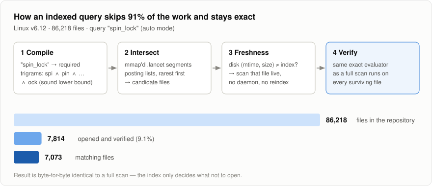
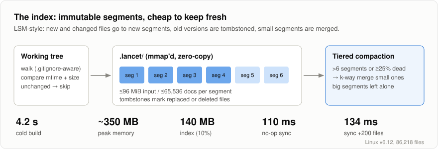

<div align="center">

# Lancet (란셋)

**코드와 문서를 찾고, 읽고, 고치는 일을 — 하나의 좌표계 위에서, 인덱스 속도로.**

[](https://github.com/CREE1116/lancet/actions/workflows/ci.yml)
[](#라이선스)

[English](./README.md) · [쿼리 문법](./docs/grammar.md) · [에이전트 지침](./docs/agent-instructions.md) · [벤치마크](#벤치마크)

</div>

<p align="center">
  
</p>

Lancet은 `rg` + `fd` + `ast-grep` + `cat` + `pdftotext`로 이어지던 도구 사슬을 **인덱스와 좌표계를 공유하는** 단일 Rust 바이너리 하나로 바꿉니다. 파일 탐색, 텍스트·구문 검색, 정확한 범위·심볼 열람, 코드 리라이트까지 — 소스 코드든 PDF든 엑셀이든 한글(HWP) 문서든 압축 파일이든 똑같이 동작합니다.

AI 코딩 에이전트와 그 옆에서 일하는 개발자를 위해 만들었습니다. 구조화된 JSON, 토큰 예산 하드 캡, 그리고 **조용한 근사치 없음**.

---

## 두 가지 핵심

### 1 · 인덱스 속도, 그러나 오래된 결과는 절대 없음

<p align="center"></p>

- 인덱스는 **열지 않을 파일만 정합니다.** 모든 후보를 풀스캔과 같은 평가기로 검증하므로 결과가 풀스캔과 "대체로"가 아니라 정확히 같습니다.
- 마지막 `lancet index` 이후 수정된 파일은 `(mtime, size)`로 감지해 그 자리에서 스캔합니다. **감시 데몬도, 재인덱싱 단계도, 오래된 결과도 없습니다.**
- 신선도를 포기하고 속도를 원할 때는 명시적으로 선택합니다: `--trust-index`는 인덱스만 보고 답합니다(Linux 커널에서 5–90 ms).

### 2 · 하나의 좌표계: 찾기 → 읽기 → 고치기

<p align="center"></p>

- 검색 결과의 42번째 줄은 `lancet read`에서도 42번째 줄입니다. `.pdf`, `.xlsx`, `.hwp`, `bundle.zip!node.log` 안에서도 마찬가지입니다. 검색과 열람이 **같은 인프로세스 추출 파이프라인**을 쓰기 때문입니다.
- `read --symbol`, `outline`, `refs`, `ast`가 모두 같은 Tree-sitter 구간을 쓰므로, 에이전트가 함수 끝 줄을 추측할 일이 없습니다.
- `lancet edit`는 `read`가 보여 준 바로 그 줄을 고칩니다. `read`가 알려 준 `rev`를 넘기면 그사이 파일이 바뀐 경우 편집을 거부하고, 구문 오류가 생기는 편집도 거부합니다.
- 리라이트와 편집은 기본이 dry-run diff이고 `--apply`로 원자적으로 반영됩니다. 다음 쿼리는 이미 바뀐 내용을 봅니다.

---

## 빠른 시작

```bash
cargo install --git https://github.com/CREE1116/lancet      # Rust 1.89+
lancet index .                                              # 선택: .lancet 인덱스를 한 번 빌드
```

```bash
lancet fd --tree --max-depth 2 .                            # 구조 파악
lancet 'near("gradient", "clip", 30) in function' src       # 검색: 불리언·근접·퍼지·AST 범위
lancet read src/search.rs --symbol execute_one              # 심볼 하나를 문서 주석까지 정확히 읽기
lancet refs SearchOptions src                               # 정의 + 참조 (주석·문자열 제외)
lancet ast '$X.unwrap()' src --lang rs --rewrite '$X?'      # 구조적 리라이트 미리보기 …
lancet ast '$X.unwrap()' src --lang rs --rewrite '$X?' --apply   # … 원자적으로 반영
lancet edit src/search.rs --symbol execute_one --with-file new.rs --rev <REV> --apply  # read 좌표 그대로 편집
```

## 명령어

| 명령 | 하는 일 |
|---|---|
| `lancet <QUERY> [PATH]` | `AND` / `OR` / `NOT`, `near` / `before`, `fuzzy("단어", k)`, `regex(...)`, `in function`, `symbol(...)`, `\| expand parent \| limit 5 \| budget tokens:1500` 같은 파이프 — [쿼리 문법](./docs/grammar.md) 참고 |
| `lancet fd` | `.gitignore` 인식 파일·폴더 탐색, `--tree`, 크기·수정 시각 필터, `--trust-index` 조회 |
| `lancet ast` | **24개 언어** Tree-sitter 구조 검색과 `--rewrite` (`$X`, `$_`, `$$$ARGS`) |
| `lancet read` | 정확한 줄 범위, `--symbol`, PDF/PPTX `--page`, 엑셀 `--sheet --rows --cols`, `archive.zip!항목`, 이어읽기 커서가 있는 `--budget-tokens` |
| `lancet edit` | `read`와 같은 좌표(`--lines`, `--symbol`, 여러 구간은 `--edits`)로 줄 교체·삭제·삽입. `--rev` 기준 잠금 compare-and-swap이라 여러 에이전트가 동시에 고쳐도 서로 덮어쓰지 않음. 구문 오류가 늘어나면 거부, `--apply` 전에는 dry-run |
| `lancet outline` | 코드 선언 골격, Markdown 목차, 워크북 스키마, 압축 파일 목록 |
| `lancet refs` | 주석·문자열 리터럴을 건너뛰는 인덱스 가속 `[def]` / `[ref]` 추적 |
| `lancet batch` | 여러 쿼리를 인덱스 한 번 열고 디렉터리 한 번 훑어 처리 |
| `lancet index` · `status` · `explain` | 인덱스 빌드·갱신, 상태 확인, 쿼리에 필요한 트라이그램 보기 |

**AST 언어:** Rust, Python, JavaScript, TypeScript, TSX, Go, C, C++, Zig, Java, C#, Kotlin, Scala, Swift, Ruby, PHP, Bash, Lua, HCL, HTML, CSS, JSON, YAML, TOML.
**문서·압축 파일** (기본 `adapters` 기능): `.pdf`, `.docx`, `.pptx`, `.odt`, `.hwp` (5.0), `.hwpx`, `.epub`, `.xlsx`, `.xls`, `.xlsm`, `.xlsb`, `.ods`, `.zip`, `.tar`, `.gz`, `.tgz` — 16 MiB 폭탄 방어 상한 안에서 프로세스 내부 추출, `--ocr`은 선택.

---

## 벤치마크

맨 위 차트는 Apple M4 Pro에서 잰 Linux 커널 v6.12(파일 86,218개, 1.4 GB) 결과입니다. [`bench/scale_bench.py`](./bench/scale_bench.py)로 재현하고 [`bench/readme_figures.py`](./bench/readme_figures.py)로 다시 그릴 수 있습니다. 인덱스 없는 `scan` 모드에서는 텍스트 검색이 ripgrep과 같은 속도이고, 배수는 인덱스에서 나옵니다.

<details>
<summary><b>크레이트 소스 코퍼스 (파일 28,352개, 452.6 MiB) — 검색·탐색·AST·문서</b></summary>

[`bench/run_bench.py`](./bench/run_bench.py), [`bench/bench_competitors.py`](./bench/bench_competitors.py), [`bench/official_suite.sh`](./bench/official_suite.sh)로 재현합니다. 콜드 인덱스 빌드 **1.17초** (36.3 MiB, 원본의 8.0%), 변경 없는 동기화 **64.6 ms**.

**텍스트 검색** (`lancet` vs `ripgrep 15.2.0`)

| 쿼리 | `rg` | lancet scan | lancet auto | lancet `--trust-index` |
|---|---:|---:|---:|---:|
| 희귀 리터럴 (`ThreadPoolBuilder`, 32건) | 307.7 ms | 310.6 ms | **60.5 ms (5.1×)** | **5.1 ms (60.3×)** |
| 일반 리터럴 (`unwrap_or_else`, 582건) | 311.3 ms | 314.6 ms | **65.4 ms (4.8×)** | **13.0 ms (23.9×)** |
| 불리언 (`"unsafe" AND "transmute" NOT "miri"`) | 469.8 ms¹ | **304.8 ms** | **62.6 ms (7.5×)** | **10.1 ms (46.5×)** |
| 정규식 (`pub unsafe fn \w+\(`) | 307.4 ms | 317.9 ms | **80.5 ms (3.8×)** | **26.9 ms (11.4×)** |
| 근접 (`near("unsafe", "transmute", 15)`) | *미지원* | 307.1 ms | **65.9 ms** | **13.6 ms** |
| 오타 퍼지 (`fuzzy("transmte", 1)`) | *미지원* | 334.7 ms | **156.7 ms** | **107.4 ms** |
| 6개 쿼리 일괄 (`lancet batch`) | ~1,850 ms | 1,570.6 ms | **93.1 ms** | **30.7 ms (쿼리당 5.1 ms)** |

*¹ `rg`는 파일 단위 `AND`에 두 번의 패스가 필요합니다.*

**파일 탐색** (`lancet fd` vs `fd 10.5.2`, `rg --files`, `find`)

| 작업 | `find` | `rg --files` | `fd` | lancet fd | lancet fd `--trust-index` |
|---|---:|---:|---:|---:|---:|
| 전체 파일 목록 (28,352) | 176.0 ms | 47.5 ms | 49.8 ms | 60.6 ms | **14.4 ms (3.5×)** |
| 확장자 + 이름 (`-e toml -p Cargo`) | — | — | 47.1 ms | 52.1 ms | **6.6 ms (7.1×)** |
| 크기 필터 (≥ 100 KiB, 637개) | 169.1 ms | — | 65.4 ms | **53.3 ms** | **5.6 ms (11.7×)** |

**구조 검색** (`lancet ast` vs `ast-grep 0.51.3`)

| Rust 패턴 | `ast-grep` | lancet scan | lancet auto | lancet `--trust-index` |
|---|---:|---:|---:|---:|
| `std::mem::transmute($X)` (19건) | 1,764.7 ms | **251.1 ms (7.0×)** | **176.6 ms (10.0×)** | **95.3 ms (18.5×)** |
| `$X.unwrap_or_else($F)` (963건) | 1,649.2 ms | **268.6 ms (6.1×)** | **245.7 ms (6.7×)** | **153.0 ms (10.8×)** |
| `unreachable!($$$ARGS)` (1,893건) | 1,782.2 ms | **484.8 ms (3.7×)** | **526.7 ms (3.4×)** | **343.3 ms (5.2×)** |
| `ThreadPoolBuilder::new()` (75건) | 1,716.7 ms | **241.5 ms (7.1×)** | **65.2 ms (26.3×)** | **13.9 ms (123.5×)** |

**문서·압축 파일** (`lancet` vs `ripgrep-all 0.10.10`, 혼합 파일 120개)

| 형식·쿼리 | `rga` 콜드 | `rga` 캐시 | lancet scan | lancet auto | lancet `--trust-index` |
|---|---:|---:|---:|---:|---:|
| PDF (`QUARTERLY_REVENUE_ANOMALY`) | 263.5 ms | 67.3 ms | **10.6 ms** | **6.9 ms** | **3.4 ms** |
| DOCX (`SLA_INDEMNITY_CLAUSE`) | 262.0 ms | 67.5 ms | **10.7 ms** | **7.6 ms** | **4.1 ms** |
| XLSX (`H100_CLUSTER_CAPEX`) | *0건* | *0건* | **11.3 ms** | **7.5 ms** | **3.6 ms** |
| ZIP 로그 (`RAFT_QUORUM_STALL`) | 274.8 ms | 67.3 ms | **12.2 ms** | **7.1 ms** | **3.5 ms** |
| HWPX (`국가클라우드보안인증검토`) | *0건* | *0건* | **11.2 ms** | **8.1 ms** | **3.7 ms** |

</details>

---

## 인덱스는 어떻게 동작하나

<p align="center"></p>

1. **보수적인 트라이그램 하한.** 쿼리와 정규식 HIR을 모든 매치가 반드시 만족하는 트라이그램 불리언 식(`Req`)으로 컴파일합니다. 포스팅 리스트는 가장 드문 것부터 교집합하고, 파일의 85% 이상에 나오는 트라이그램은 건너뜁니다. 식이 보수적이라 인덱스는 후보를 줄일 뿐 매치를 놓치지 않습니다.
2. **인덱스 위의 퍼지 검색.** q-gram 보조정리에 따라 트라이그램이 `|G|`개인 단어는 편집 거리 `k` 안에서 최소 `|G| − 3k`개(한글 음절은 `|G| − k`개)를 유지하므로, `fuzzy(...)`도 풀스캔 대신 `k`-of-`n` 포스팅 집계로 처리합니다.
3. **3단 AST 매칭.** 패턴의 식별자 리터럴로 (a) 인덱스에서 파일을 거르고, (b) SIMD `memmem` 검사를 통과한 파일만 Tree-sitter로 파싱하고, (c) 리터럴이 없는 서브트리는 아예 건너뛴 뒤, 미리 컴파일한 `u16 kind_id` 패턴 트리로 매칭합니다.
4. **유니코드 대소문자 궤도.** 대소문자 동치 문자(`k`, `K`, 켈빈 `K`)를 인덱스와 평가기 모두에서 하나의 대표 문자로 접고, ASCII 리터럴은 정규식 오토마타 대신 `memchr2` 양방향 대소문자 스캔을 씁니다.
5. **제로카피 `LANCET04` 세그먼트.** 인덱스를 열 때는 `mmap`한 파일의 40바이트 헤더만 읽습니다. 조회는 할당이 없고, 줄 번호는 실제로 매치된 구간에서만 계산합니다.
6. **메모리가 묶인 LSM 유지보수.** 바뀐 파일은 새 불변 세그먼트로 가고 이전 버전은 툼스톤 처리되며, 계층형 컴팩션이 작은 세그먼트를 합칩니다. 빌드 버퍼를 세그먼트 사이에 재사용해 Linux 커널 콜드 빌드도 350 MB 안팎에 머뭅니다.

**정확성 보장.** 잘못된 쿼리, 모르는 플래그, 파싱할 수 없는 패턴은 추측하지 않고 정확한 진단과 함께 실패합니다. `--rewrite`와 `edit`는 `--apply` 없이 파일을 건드리지 않고, `--apply`는 `--limit`과 함께 쓸 수 없으며(부분 리라이트 방지), `edit --rev`는 읽은 뒤 바뀐 파일에 덮어쓰지 않습니다. 신선도는 mtime·크기·ctime·inode로 판정합니다. Windows는 표준 라이브러리로 ctime과 inode를 제공하지 않으므로, 크기가 같고 mtime까지 되돌린 수정은 `lancet index`나 `--no-index`로만 잡힙니다.

---

## 왜 `cat`, `sed`, 기본 `Read` 대신 `lancet read`인가?

- **모든 형식에서 검색과 같은 줄 번호** — PDF, 오피스 문서, HWP, 압축 파일 내부 항목까지.
- **의미 단위 절개** — `--symbol`, `--page`, `--sheet --rows --cols`로 원하는 단위만 한 번에.
- **토큰 예산 하드 캡** — `--budget-tokens 800`은 경계에서 멈추고 이어 읽을 `next_line`을 돌려줍니다.
- **임시 파일·외부 변환기 없음** — 16 MiB 추출 상한 안에서 컨테이너를 메모리에서 바로 엽니다.

## AI 에이전트와 함께 쓰기

[`docs/agent-instructions.md`](./docs/agent-instructions.md)를 `AGENTS.md`, `CLAUDE.md`, 시스템 규칙에 넣으세요. 에이전트가 여러 도구를 엮은 셸 명령 대신 구조화되고 토큰 예산이 걸린 `lancet` 호출을 쓰게 됩니다.

## 설치 옵션

```bash
cargo install --git https://github.com/CREE1116/lancet                          # 전체 빌드
cargo install --git https://github.com/CREE1116/lancet --no-default-features    # 텍스트·코드 전용: Tree-sitter, 문서 어댑터 제외
```

## 라이선스

[Apache License 2.0](./LICENSE-APACHE) 또는 [MIT](./LICENSE-MIT) 중 원하는 쪽을 선택하는 듀얼 라이선스입니다.
