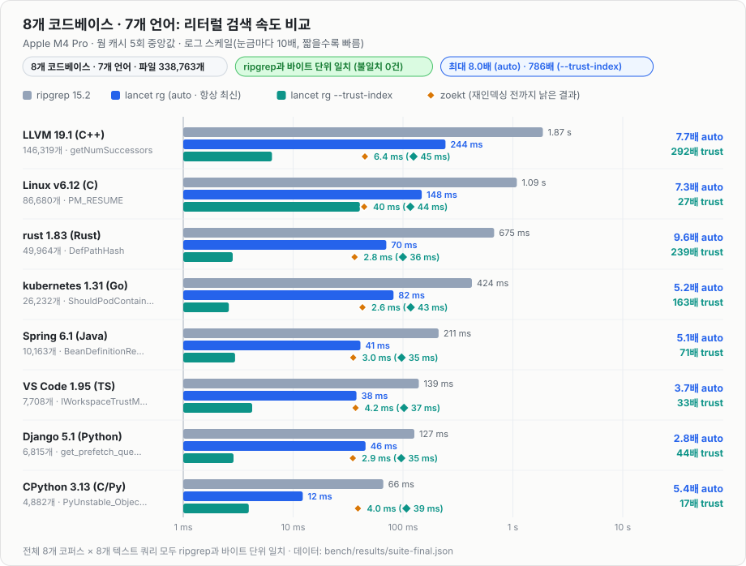
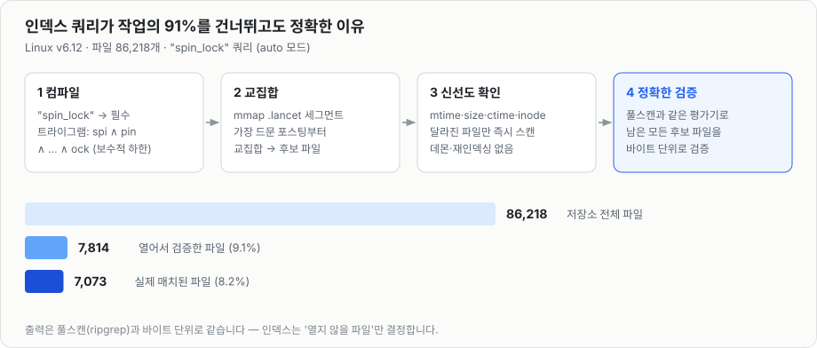
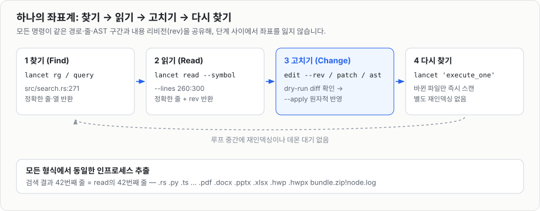
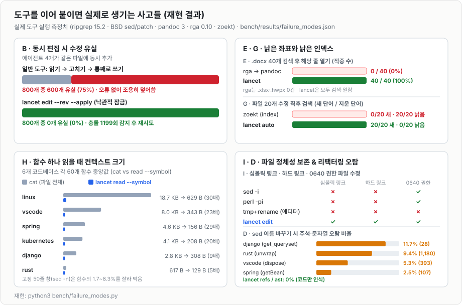
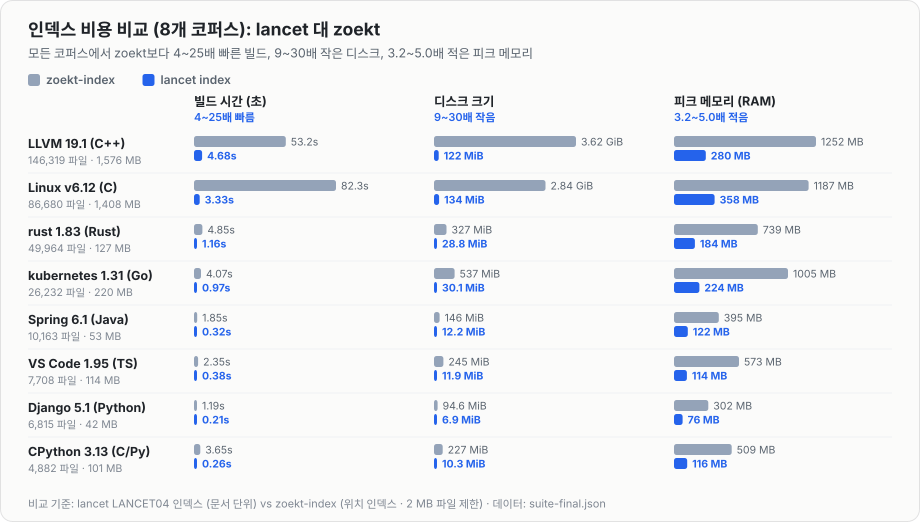
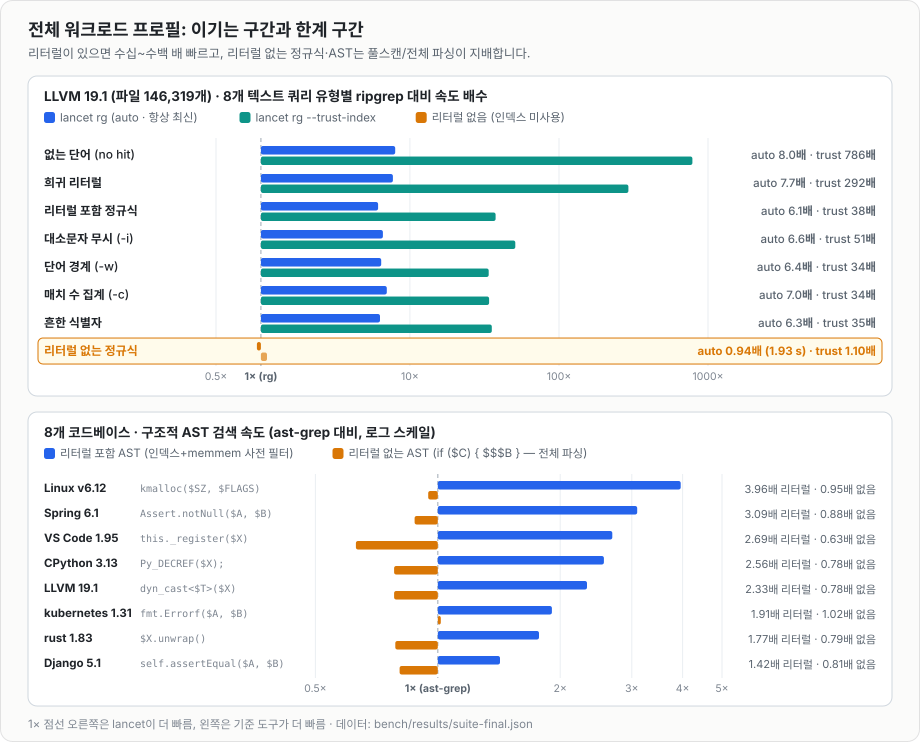
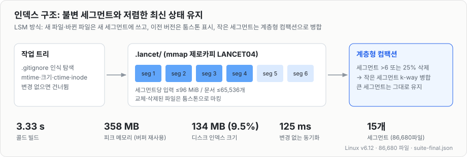
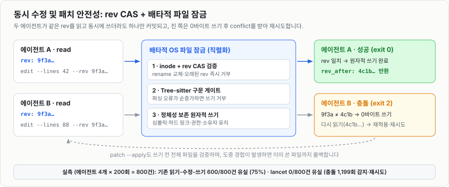

<div align="center">

# Lancet (란셋)

**코드와 문서를 찾고, 읽고, 고치는 일을 — 하나의 좌표계 위에서, 인덱스로 훨씬 빠르게.**

[](https://github.com/CREE1116/lancet/actions/workflows/ci.yml)
[](#라이선스)

[공식 문서](https://cree1116.github.io/lancet/ko/docs/) · [English](./README.md) · [ripgrep 대조표](./docs/rg-parity.md) · [에이전트 지침](./docs/agent-instructions.md) · [벤치마크](#벤치마크)

</div>

<p align="center">
  
</p>

Lancet은 `rg` + `fd` + `ast-grep` + `cat` + `pdftotext`로 이어지던 도구 사슬을 **인덱스와 좌표계를 공유하는** 단일 Rust 바이너리 하나로 바꿉니다. 파일 탐색, 텍스트·구문 검색, 정확한 범위·심볼 열람, 코드 리라이트까지 — 소스 코드든 PDF든 엑셀이든 한글(HWP) 문서든 압축 파일이든 똑같이 동작합니다.

기존 CLI 도구들은 사람이 단계 사이를 이어 붙인다는 전제로 설계되었습니다. Lancet은 AI 코딩 에이전트와 그 옆에서 일하는 개발자가 직접 조합해 쓰는 환경을 전제로 처음부터 설계했습니다. 구조화된 JSON, 토큰 예산 하드 캡, 그리고 **조용한 근사치 없음**.

---

## 두 가지 핵심

### 1 · 인덱스로 빠르게, 결과는 기본적으로 최신

<p align="center"></p>

- 인덱스는 **열지 않을 파일만 정합니다.** 모든 후보를 풀스캔과 같은 평가기로 검증하므로 결과가 풀스캔과 "대체로"가 아니라 정확히 같습니다.
- 마지막 `lancet index` 이후 수정된 파일은 `(mtime, size, ctime, inode)`와 타임스탬프 경계 검사로 감지해 그 자리에서 스캔합니다. **감시 데몬도, 재인덱싱 단계도 없습니다.** (표준 라이브러리가 `mtime`·`size`만 제공하는 Windows의 예외는 아래 [핵심 기술](#핵심-기술) 참고.)
- 신선도를 포기하고 속도를 원할 때는 명시적으로 선택합니다: `--trust-index`는 인덱스만 보고 답합니다(Linux 커널에서 3–86 ms).

### 2 · 하나의 좌표계: 찾기 → 읽기 → 고치기

<p align="center"></p>

- 검색 결과의 42번째 줄은 `lancet read`에서도 42번째 줄입니다. `.pdf`, `.xlsx`, `.hwp`, `bundle.zip!node.log` 안에서도 마찬가지입니다. 검색과 열람이 **같은 인프로세스 추출 파이프라인**을 쓰기 때문입니다.
- `read --symbol`, `outline`, `refs`, `ast`가 모두 같은 Tree-sitter 구간을 쓰므로, 에이전트가 함수 끝 줄을 추측할 일이 없습니다.
- `lancet edit`는 `read`가 보여 준 바로 그 줄을 고칩니다. `read`가 알려 준 `rev`를 넘기면 그사이 파일이 바뀐 경우 편집을 거부하고, 구문 오류가 생기는 편집도 거부합니다.
- `lancet patch`는 unified diff(`git diff` / `diff -u`)를 여러 파일에 걸쳐 같은 보장으로 적용합니다. 정확한 hunk 매칭, 전체 파일 사전 검증과 동시 쓰기 충돌 시 롤백, 구문 오류 증가 거부를 지원합니다.
- 리라이트·편집·패치는 기본이 dry-run diff이고 `--apply`로 원자적으로 반영됩니다. 다음 쿼리는 이미 바뀐 내용을 봅니다.

---

## 빠른 시작

```bash
# macOS / Linux (Homebrew)
brew tap CREE1116/lancet https://github.com/CREE1116/lancet
brew install CREE1116/lancet/lancet   # 사전 빌드 바이너리, tap에는 저장소 URL 필요

# macOS / Linux (빌드 없는 원라인 설치 스크립트)
curl -fsSL https://raw.githubusercontent.com/CREE1116/lancet/main/install.sh | sh

# Windows PowerShell (프리빌트 바이너리)
irm https://raw.githubusercontent.com/CREE1116/lancet/main/install.ps1 | iex

# 선택: .lancet 인덱스를 한 번 빌드
lancet index .
```

```bash
lancet fd --tree --max-depth 2 .                            # 구조 파악
lancet rg -w spin_lock src                                  # ripgrep 호환 CLI (인덱스 가속)
lancet read src/rg.rs --symbol run                           # 심볼 하나를 문서 주석까지 정확히 읽기
lancet refs SearchOptions src                               # 정의 + 참조 (주석·문자열 제외)
lancet ast '$X.unwrap()' src --lang rs --rewrite '$X?'      # 구조적 리라이트 미리보기 …
lancet ast '$X.unwrap()' src --lang rs --rewrite '$X?' --apply   # … 원자적으로 반영
lancet edit src/rg.rs --symbol run --with-file new.rs --rev <REV> --apply  # read 좌표 그대로 편집
git diff | lancet patch --apply                             # unified diff를 여러 파일에 원자적으로 적용
```

> **에이전트 우선 `lancet rg` 기본값:** `lancet rg`는 파이프로 넘길 때도 좌표가 끊기지 않도록 **줄 번호(`-n`)를 기본으로 켠 상태**를 유지하고, 터미널(TTY) 출력에는 자동으로 색상을 입힙니다(`--color auto`, 파이프 시 비활성). ripgrep과 똑같이 파이프 시 줄 번호를 끄려면 `-N`을 넘기면 됩니다.

## 명령어

| 명령 | 하는 일 |
|---|---|
| `lancet rg [FLAGS] PATTERN [PATH...]` | 항상 최신인 lancet 인덱스와 문서 추출기 위에서 동작하는 ripgrep 호환 플래그(`-L`, `--max-depth`, `--max-filesize`, `--color`, `-U`, `-w`, `-A`/`-B`/`-C`, `--json` 등; 파이프 시에도 `-n` 기본, `-N`으로 해제) — [ripgrep 대조표](./docs/rg-parity.md) 참고 |
| `lancet fd` | `.gitignore` 인식 파일·폴더 탐색, `--tree`(폴더만 보려면 `--dirs`), 크기·수정 시각 필터, `--trust-index` 조회 |
| `lancet ast` | **24개 언어** Tree-sitter 구조 검색과 `--rewrite` (`$X`, `$_`, `$$$ARGS`, C 계열 언어의 `if ($C) $S`·`{ $$$B }` 같은 문장 메타변수 포함) |
| `lancet read` | 정확한 줄 범위, `--symbol`, PDF/PPTX `--page`, 엑셀 `--sheet --rows --cols`, `archive.zip!항목`, 이어읽기 커서가 있는 `--budget-tokens` |
| `lancet edit` | `read`와 같은 좌표(`--lines`, `--symbol`, 유일해야 하는 정확한 텍스트 `--find`, 여러 구간은 `--edits`)로 줄 교체·삭제·삽입. `--rev` 기준 잠금 compare-and-swap이라 여러 에이전트가 동시에 고쳐도 서로 덮어쓰지 않음. 구문 오류가 늘어나면 거부, `--apply` 전에는 dry-run |
| `lancet write` | 새 파일 만들기, 또는 읽을 때 받은 `--rev`로 파일 전체 교체. `--apply` 전에는 미리보기 |
| `lancet patch` | unified diff(`git diff`, `diff -u`, rename·모드 변경·빈 파일 포함, 바이너리 변경은 거부) 적용: 정확한 hunk 매칭(줄 번호가 밀렸으면 가장 가까운 고유 위치 탐색, 퍼지 추측 없음), 전체 파일 검증 및 동시 쓰기 충돌 시 롤백, 구문 오류 증가 거부, `--apply` 전에는 dry-run |
| `lancet mcp` | 내장 Model Context Protocol(`stdio`) 서버. CLI 인자를 그대로 받는 `lancet` 도구 하나를 제공하며, 셸이 없는 클라이언트용입니다(`--root`, `--read-only`, `--trust-index`) |
| `lancet outline` | 코드 선언 골격, Markdown 목차, 워크북 스키마, 압축 파일 목록 |
| `lancet refs` | 주석·문자열 리터럴을 건너뛰는 인덱스 가속 `[def]` / `[ref]` 추적. `--rank '*Service' --kind class`로 많이 쓰이는 선언부터 나열 |
| `lancet index` | 인덱스 생성·갱신 (`--status`로 상태 확인) |

**AST 언어:** Rust, Python, JavaScript, TypeScript, TSX, Go, C, C++, Zig, Java, C#, Kotlin, Scala, Swift, Ruby, PHP, Bash, Lua, HCL, HTML, CSS, JSON, YAML, TOML.
**문서·압축 파일** (기본 `adapters` 기능): `.pdf`, `.docx`, `.pptx`, `.odt`, `.hwp` (5.0), `.hwpx`, `.epub`, `.xlsx`, `.xls`, `.xlsm`, `.xlsb`, `.ods`, `.zip`, `.tar`, `.gz`, `.tgz` — 16 MiB 폭탄 방어 상한 안에서 프로세스 내부 추출, `--ocr`은 선택.

---

## 왜 하나의 도구인가?

도구를 이어 붙이면 사고는 **단계 사이**에서 납니다. 도구마다 좌표, 파일 범위, 바이너리 판정, 시점에 대한 생각이 다르고, 어느 도구도 다른 에이전트가 같은 파일을 고치고 있다는 걸 모릅니다. 실제 도구로 재현한 결과입니다([`bench/failure_modes.py`](./bench/failure_modes.py)).

<p align="center">
  
</p>

| 도구 체인 | 실제로 일어난 일 | lancet |
|---|---|---|
| `rg -n` → `sed -i` 두 번 | 두 번째 수정이 **엉뚱한 줄**을 덮어씀. 둘 다 종료 코드 0 | `edit --edits`(원본 좌표) 또는 `conflict` |
| 에이전트 4개: 읽기 → 고치기 → 통째로 쓰기 | 수정 800개 중 **600개**가 조용히 유실 | `edit --rev`: 800개 중 **0개** 유실 |
| 오래된 hunk가 섞인 `patch -p1` | 한 파일만 바뀌고 하나는 거부 — **반쯤 적용** | `patch`: 아무것도 안 씀, `conflict` |
| `sed`로 이름 바꾸기 | 주석·문자열까지 바꿈: 출현의 **0.3~11.7%** | `refs`·`ast`는 코드만 봄 |
| `.docx`에 `rga` → `pandoc` | 읽은 줄 40개 중 **0개**에 검색어가 있음 | **40개 중 40개**(검색과 읽기가 같은 추출) |
| 파일 20개 수정 직후 zoekt | 새 텍스트 **0개**, 지운 텍스트 **20개** 파일에서 찾음 | auto: **20개**와 **0개** |
| `sed -i`·`perl -pi`·에디터 쓰기 | **하드 링크·심볼릭 링크**를 깨고 `0640` 권한을 잃음 | 같은 파일 유지: 링크·권한·소유자 보존 |

여러 에이전트 규약(`rev`, compare-and-swap, `conflict`), 소유권과 파일 정체성, 문서까지 범위를 넓힌 이유, 각 설계 선택과 대안, lancet이 아직 지는 곳까지 정리한 전체 문서는 **[docs/why-one-tool.ko.md](./docs/why-one-tool.ko.md)**에 있습니다.

---

## 벤치마크

**코드베이스 8개, 언어 7개**([`bench/suite.py`](./bench/suite.py), 전체 표는 [`bench/results/SUITE.md`](./bench/results/SUITE.md)). lancet의 모든 텍스트 출력을 ripgrep과 바이트 단위로 대조했고, AST 매치 집합은 ast-grep과 교차 검증하되 스캔 범위 차이(`.h` 헤더 포함 여부 등)와 문장 매칭 차이(`if` vs `if-else`)는 문서에 명시했습니다.

| 코퍼스 | 파일 | 인덱스 빌드 · 크기 (lancet / zoekt) | 텍스트: auto / trust vs rg | 리터럴 AST vs ast-grep |
|---|---:|---|---|---|
| Linux v6.12 (C) | 86,680 | 3.3 s · 134 MB / 82 s · 2.9 GB | 5.8~7.5배 / 13~403배 | 4.0배 |
| LLVM 19.1 (C++) | 146,319 | 4.7 s · 122 MB / 53 s · 3.7 GB | 6.1~8.0배 / 34~786배 | 2.3배 |
| rust 1.83 (Rust) | 49,964 | 1.2 s · 29 MB / 4.9 s · 327 MB | 1.5~9.6배 / 2~273배 | 1.8배 |
| kubernetes 1.31 (Go) | 26,232 | 1.0 s · 30 MB / 4.1 s · 537 MB | 3.5~5.8배 / 9~210배 | 1.9배 |
| VS Code 1.95 (TS) | 7,708 | 0.4 s · 12 MB / 2.4 s · 245 MB | 2.1~3.9배 / 4~63배 | 2.7배 |
| Django 5.1 (Python) | 6,815 | 0.2 s · 7 MB / 1.2 s · 95 MB | 2.4~2.9배 / 10~60배 | 1.4배 |
| CPython 3.13 (C/Python) | 4,882 | 0.3 s · 10 MB / 3.7 s · 227 MB | 3.0~5.4배 / 5~30배 | 2.6배 |
| Spring 6.1 (Java) | 10,163 | 0.3 s · 12 MB / 1.9 s · 146 MB | 2.9~5.3배 / 6~95배 | 3.1배 |

lancet이 **이기지 못하는** 곳: 리터럴 없는 정규식(인덱스가 걸러 줄 게 없어 ripgrep과 같거나 최대 1.4배 느림)과 리터럴 없는 구조 AST 패턴(ast-grep 속도의 0.6~1.0배). 자세한 내용은 [docs/why-one-tool.ko.md 7절](./docs/why-one-tool.ko.md#7-lancet이-이기지-못하는-곳).

> **에이전트·인덱스 경쟁 도구(`tgrep`, `grix`, `aft`, `tensor-grep`, `probe`) 비교 — [`bench/results/COMPETITORS.md`](./bench/results/COMPETITORS.md):**
> 상주 프로세스 없이도 **편집 직후(0 ms) 20/20 신선도**를 지키고(`aft` 워처 지연·`tgrep` 서버리스는 `0/20`), 인덱스는 `aft`/`tgrep` 대비 **1/3~1/7 크기**(Linux 기준 `141.8 MB` vs `368.5 MB`/`955.2 MB`), 빌드 피크 메모리는 `grix`의 **약 1/3**(`353.5 MB` vs `1,001.6 MB`; LLVM `272.0 MB` vs `893.6 MB`)이며, `rg` 매치 수 일치 **20/20**과 4개 코퍼스 전부에서 가장 빠른 리터럴 AST 검색(Linux `1.7 s` vs `ast-grep` `10.7 s` / `aft` `43.0 s`)을 단일 바이너리에서 제공합니다. 다만 **모든 항목에서 1등은 아닙니다**: 상주 `tgrep serve`는 Rust/LLVM `regex with literal`(`119.2 ms`/`19.9 ms` vs `lancet auto` `508.7 ms`/`295.8 ms`)에서, `grix --no-auto-index`는 Linux 희귀 리터럴(`11.5 ms` vs `--trust-index` `43.6 ms`)에서, 상주 `aft`는 Rust 희귀 리터럴(`8.5 ms` vs `lancet auto` `73.5 ms`)에서 더 빠릅니다. (`Apple Silicon macOS arm64` 단일 머신 측정치이며 Linux x86_64 재현 검증은 열려 있습니다.)

<p align="center">
  
</p>

<p align="center">
  
</p>

위 차트들은 Apple M4 Pro(웜 캐시, `hyperfine` 5회 중앙값)에서 측정한 [`bench/results/suite-final.json`](./bench/results/suite-final.json)과 [`bench/results/failure_modes.json`](./bench/results/failure_modes.json) 데이터를 바탕으로 [`bench/readme_figures.py`](./bench/readme_figures.py)로 생성했습니다. 인덱스 없는 `--no-index` / `scan` 모드에서는 텍스트 검색이 ripgrep과 같은 속도이며, 위 배수는 인덱스에서 나옵니다.

<details>
<summary><b>크레이트 소스 코퍼스 (파일 28,352개, 452.6 MiB) — 검색·탐색·AST·문서</b></summary>

[`bench/run_bench.py`](./bench/run_bench.py), [`bench/bench_competitors.py`](./bench/bench_competitors.py), [`bench/official_suite.sh`](./bench/official_suite.sh)로 재현합니다. 콜드 인덱스 빌드 **1.17초** (36.3 MiB, 원본의 8.0%), 변경 없는 동기화 **64.6 ms**.

**텍스트 검색** (`lancet` vs `ripgrep 15.2.0`)

| 쿼리 | `rg` | lancet scan | lancet auto | lancet `--trust-index` |
|---|---:|---:|---:|---:|
| 희귀 리터럴 (`ThreadPoolBuilder`, 32건) | 307.7 ms | 310.6 ms | **60.5 ms (5.1×)** | **5.1 ms (60.3×)** |
| 일반 리터럴 (`unwrap_or_else`, 582건) | 311.3 ms | 314.6 ms | **65.4 ms (4.8×)** | **13.0 ms (23.9×)** |
| 정규식 (`pub unsafe fn \w+\(`) | 307.4 ms | 317.9 ms | **80.5 ms (3.8×)** | **26.9 ms (11.4×)** |


**파일 탐색** (`lancet fd` vs `fd 10.5.2`, `rg --files`, `find`)

| 작업 | `find` | `rg --files` | `fd` | lancet fd | lancet fd `--trust-index` |
|---|---:|---:|---:|---:|---:|
| 전체 파일 목록 (28,352) | 176.0 ms | 47.5 ms | 49.8 ms | 60.6 ms | **14.4 ms (3.5×)** |
| 확장자 + 이름 (`-e toml -p Cargo`) | — | — | 47.1 ms | 52.1 ms | **6.6 ms (7.1×)** |
| 크기 필터 (≥ 100 KiB, 637개) | 169.1 ms | — | 65.4 ms | **53.3 ms** | **5.6 ms (11.7×)** |

**구조 검색** (`lancet ast` vs `ast-grep 0.51.3`)

| Rust 패턴 | `ast-grep` | lancet scan | lancet auto | lancet `--trust-index` |
|---|---:|---:|---:|---:|
| `std::mem::transmute($X)` (19건) | 1,764.7 ms | **251.1 ms (7.0×)** | **176.6 ms (10.0×)** | **95.3 ms (18.5×)** |
| `$X.unwrap_or_else($F)` (963건) | 1,649.2 ms | **268.6 ms (6.1×)** | **245.7 ms (6.7×)** | **153.0 ms (10.8×)** |
| `unreachable!($$$ARGS)` (1,893건) | 1,782.2 ms | **484.8 ms (3.7×)** | **526.7 ms (3.4×)** | **343.3 ms (5.2×)** |
| `ThreadPoolBuilder::new()` (75건) | 1,716.7 ms | **241.5 ms (7.1×)** | **65.2 ms (26.3×)** | **13.9 ms (123.5×)** |

**문서·압축 파일** (`lancet` vs `ripgrep-all 0.10.10`, 혼합 파일 120개)

| 형식·쿼리 | `rga` 콜드 | `rga` 캐시 | lancet scan | lancet auto | lancet `--trust-index` |
|---|---:|---:|---:|---:|---:|
| PDF (`QUARTERLY_REVENUE_ANOMALY`) | 263.5 ms | 67.3 ms | **10.6 ms** | **6.9 ms** | **3.4 ms** |
| DOCX (`SLA_INDEMNITY_CLAUSE`) | 262.0 ms | 67.5 ms | **10.7 ms** | **7.6 ms** | **4.1 ms** |
| XLSX (`H100_CLUSTER_CAPEX`) | *0건* | *0건* | **11.3 ms** | **7.5 ms** | **3.6 ms** |
| ZIP 로그 (`RAFT_QUORUM_STALL`) | 274.8 ms | 67.3 ms | **12.2 ms** | **7.1 ms** | **3.5 ms** |
| HWPX (`국가클라우드보안인증검토`) | *0건* | *0건* | **11.2 ms** | **8.1 ms** | **3.7 ms** |

</details>

---

## 핵심 기술

### 1 · 경량 문서 단위 트라이그램 인덱스 (`LANCET04` LSM)

<p align="center"></p>

- **위치 인덱스가 아닌 문서 단위 인덱스.** 모든 바이트 오프셋을 저장하면 Zoekt처럼 원본의 2.1~2.8배까지 커지지만, `LANCET04`는 파일 단위 트라이그램 포스팅만 저장해 **원본의 8~23% 크기**(Zoekt보다 9~30배 작음)와 **4~25배 빠른 빌드**를 달성합니다.
- **제로카피 mmap 세그먼트와 메모리 제한 LSM.** 인덱스를 열 때는 `mmap` 파일의 40바이트 헤더만 읽고 조회 시 할당이 없으며, 줄 번호는 실제로 매치된 구간에서만 계산합니다. 수정된 파일은 불변 세그먼트에 추가하고 이전 버전은 툼스톤 처리한 뒤 계층형 컴팩션으로 합치며, 빌드 버퍼를 재사용해 Linux 커널 콜드 빌드도 **피크 358 MB**에 머뭅니다.

### 2 · 보수적 후보 선별과 정확한 재검증

- **보수적인 트라이그램 하한.** 검색 패턴(리터럴, 정규식 HIR, AST 패턴의 리터럴)을 모든 매치가 반드시 만족해야 하는 트라이그램 불리언 식(`Req`)으로 컴파일합니다. 포스팅 리스트는 가장 드문 것부터 교집합하고(파일 85% 이상에 나오는 초고빈도 트라이그램은 건너뜀), 식이 보수적이어서 후보만 줄일 뿐 매치를 절대 빠뜨리지 않습니다.
- **남은 후보에 풀스캔 평가기 직접 실행.** 선별된 후보 파일과 인덱싱 이후 `(mtime, size, ctime, inode)` 또는 타임스탬프 경계가 바뀐 파일은 풀스캔과 완전히 동일한 평가기로 검증합니다. 그 결과 8개 코퍼스 전체에서 **ripgrep과 바이트 단위로 동일한 출력**을 냅니다.

### 3 · 다중 에이전트 동시 수정과 패치 안전성

<p align="center"></p>

- **낙관적 동시성 제어(`rev` CAS + 배타적 파일 잠금).** 모든 `read`는 파일 바이트의 XXH3-64 해시 `rev`를 반환합니다. `edit --rev --apply`, `ast --rewrite --apply`, `patch --apply`는 배타적 파일 잠금을 잡은 뒤 `inode`(rename 교체 감지)와 `rev`가 일치할 때만 씁니다. 경합에서 진 쪽은 **0바이트도 쓰지 않은 채** `conflict`(종료 코드 2)를 받아 다시 읽고 재시도하며, 성공 측은 `rev_after`를 받아 재읽기 없이 다음 수정을 이어갈 수 있습니다.
- **다중 구간·다중 파일 원자성.** `--edits`는 한 파일의 여러 수정을 원본 줄 좌표 기준으로 한 번에 처리하고, `patch --apply`는 쓰기 전에 모든 파일을 먼저 검증하며 쓰는 도중 경합이 나면 이미 쓴 파일까지 롤백합니다. 이 롤백은 best-effort이며 crash-atomic은 아닙니다. 여러 파일 패치 도중 크래시나 정전이 나면 일부 파일만 써진 상태가 남을 수 있습니다.
- **구문 오류 게이트와 파일 정체성 보존.** 수정 전후를 Tree-sitter로 파싱해 구문 오류가 순증가하면 쓰기를 거부합니다. 또한 심볼릭 링크는 유지한 채 대상 파일만 고치고, 다중 하드 링크 파일은 제자리에 다시 쓰며, OS가 허용하는 범위에서 권한·소유자·그룹을 그대로 보존합니다. 일반 쓰기는 크래시에 안전하지만(임시 파일, fsync, 원자적 rename, 디렉터리 fsync), 하드 링크 파일의 제자리 쓰기는 그렇지 않아 쓰는 도중 크래시가 나면 일부만 써질 수 있습니다.

### 4 · 3단 AST 리터럴 사전 필터와 상한이 있는 `$$$` 매칭

- **일치할 리 없는 파일·서브트리 파싱 생략.** 패턴의 식별자 리터럴로 (a) 트라이그램 인덱스에서 파일을 거르고, (b) SIMD `memmem` 검사를 통과한 파일만 Tree-sitter로 파싱하며, (c) 리터럴이 없는 AST 서브트리는 아예 건너뛴 뒤 미리 컴파일한 `u16 kind_id` 패턴 트리로 매칭합니다.
- **메모이제이션과 시도 예산.** 다중 와일드카드(`$$$`) 백트래킹은 메모이제이션과 노드당 시도 예산으로 묶어, 인자가 많은 호출에서도 약 0.03초 안에 끝나며 병적인 패턴도 멈추지 않고 경고와 함께 종료됩니다.

**정확성 및 플랫폼 예외.** 잘못된 쿼리, 모르는 플래그, 파싱할 수 없는 패턴은 추측하지 않고 정확한 진단과 함께 실패합니다. `--rewrite`, `edit`, `patch`는 `--apply` 없이 디스크를 건드리지 않으며, `--apply`는 `--limit`과 함께 쓸 수 없습니다(부분 리라이트 방지). 신선도는 `mtime`, `size`, `ctime`, `inode` 및 파일시스템 타임스탬프 경계 창으로 판정하며, 표준 라이브러리가 `ctime`과 `inode`를 제공하지 않는 Windows에서는 파일 크기가 같고 `mtime`까지 되돌린 수정만 `lancet index` 또는 `--no-index`로 잡아야 합니다.

---

## 왜 `cat`, `sed`, 기본 `Read` 대신 `lancet read`인가?

- **모든 형식에서 검색과 같은 줄 번호** — PDF, 오피스 문서, HWP, 압축 파일 내부 항목까지.
- **의미 단위 절개** — `--symbol`, `--page`, `--sheet --rows --cols`로 원하는 단위만 한 번에.
- **토큰 예산 하드 캡** — `--budget-tokens 800`은 경계에서 멈추고 이어 읽을 `next_line`을 돌려줍니다.
- **임시 파일·외부 변환기 없음** — 16 MiB 추출 상한 안에서 컨테이너를 메모리에서 바로 엽니다.

## AI 에이전트와 함께 쓰기

- **MCP 서버 (`lancet mcp`):** Claude Code, Cursor, Claude Desktop, Codex, Antigravity에서 바로 연결하는 내장 stdio 서버 — **[docs/mcp.md](./docs/mcp.md)** 참고.
- **공식 에이전트 스킬:** [`skills/lancet/SKILL.md`](./skills/lancet/SKILL.md)(과 [`skills/lancet/references/mcp-config.json`](./skills/lancet/references/mcp-config.json))를 `~/.claude/skills`, `~/.codex/skills`, `~/.gemini/config/skills` 또는 `.agents/skills`에 설치하세요.
- **시스템 규칙 / `AGENTS.md`:** [`docs/agent-instructions.md`](./docs/agent-instructions.md)를 `AGENTS.md`나 `CLAUDE.md`에 넣어 셸 체인 대신 구조화되고 토큰 예산이 걸린 `lancet` 호출을 쓰게 할 수 있습니다.

## 설치 옵션

```bash
# 프리빌트 바이너리 (Rust 설치 불필요)
brew tap CREE1116/lancet https://github.com/CREE1116/lancet && brew install CREE1116/lancet/lancet
curl -fsSL https://raw.githubusercontent.com/CREE1116/lancet/main/install.sh | sh     # macOS / Linux
irm https://raw.githubusercontent.com/CREE1116/lancet/main/install.ps1 | iex         # Windows x64
cargo binstall --git https://github.com/CREE1116/lancet lancet                       # cargo-binstall (태그 릴리스 기준)

# 소스 빌드 (Rust 1.89+)
cargo install --git https://github.com/CREE1116/lancet                               # 전체 빌드
cargo install --git https://github.com/CREE1116/lancet --no-default-features         # 텍스트·코드 전용: Tree-sitter, 문서 어댑터 제외
```

바이너리 크기(macOS arm64 릴리스): 전체 **약 40 MB**(Tree-sitter 문법 24개 + 문서 어댑터), `--no-default-features`는 **약 4 MB**.

## 라이선스

[Apache License 2.0](./LICENSE-APACHE) 또는 [MIT](./LICENSE-MIT) 중 원하는 쪽을 선택하는 듀얼 라이선스입니다.
