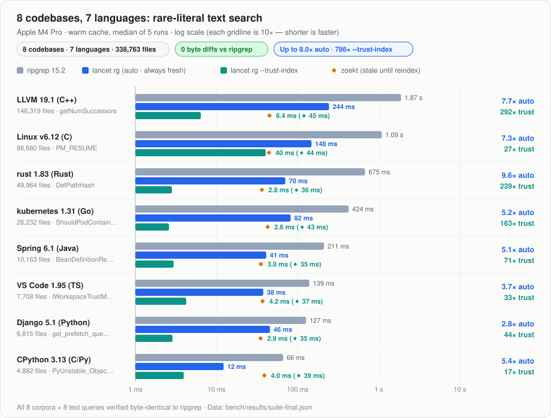
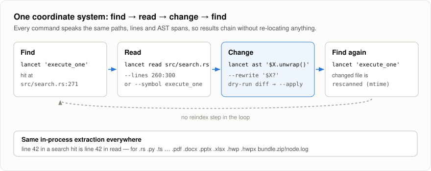
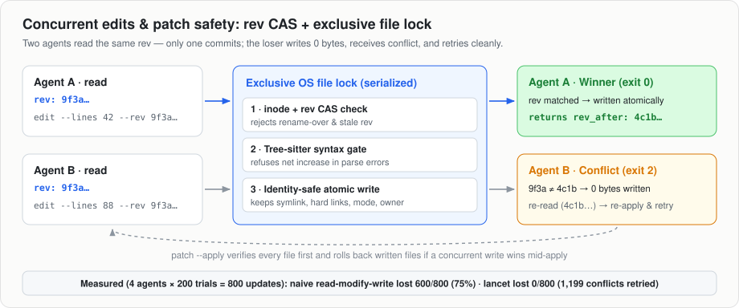

<div align="center">

# Lancet

**Find, read, and change code and documents — on one coordinate system, at index speed.**

[](https://github.com/CREE1116/lancet/actions/workflows/ci.yml)
[](#license)

[Docs](https://cree1116.github.io/lancet/docs/) · [한국어](./README.ko.md) · [ripgrep parity](./docs/rg-parity.md) · [Agent instructions](./docs/agent-instructions.md) · [Benchmarks](#benchmarks)

</div>

<p align="center">
  
</p>

Lancet is a single Rust binary that replaces the `rg` + `fd` + `ast-grep` + `cat` + `pdftotext` chain with one tool that **shares an index and a coordinate system** across every step: discover files, search text and syntax, read exact ranges and symbols, and rewrite code — in source files, PDFs, spreadsheets, Korean HWP documents, and archives alike.

Traditional CLI tools assume a human is stitching them together; Lancet is designed from the ground up for AI coding agents and the developers working beside them — structured JSON, hard token budgets, and **no silent approximations**.

---

## Two ideas

### 1 · Index speed, fresh results by default

<p align="center"></p>

- The index **only decides what not to open.** Every candidate is checked by the same evaluator a full scan uses, so indexed results are identical to a scan — not "usually the same".
- Files edited since the last `lancet index` are detected by `(mtime, size, ctime, inode)` plus a racy-timestamp check and scanned live. **No watcher daemon, no reindex step.** (On Windows, where Rust's stdlib exposes only `mtime` and `size`, see [Core architecture](#core-architecture).)
- When you *want* to trade freshness for speed, you say so explicitly: `--trust-index` answers straight from the index (3–86 ms on the Linux kernel).

### 2 · One coordinate system: find → read → change

<p align="center"></p>

- A search hit at line 42 is line 42 in `lancet read` — even inside a `.pdf`, `.xlsx`, `.hwp`, or `bundle.zip!node.log`, because search and read run the **same in-process extraction**.
- `read --symbol`, `outline`, `refs`, and `ast` all resolve the same Tree-sitter spans, so an agent never guesses where a function ends.
- `lancet edit` changes the exact lines `read` showed. Pass the `rev` that `read` reported and the edit refuses to run if the file changed in between; edits that add syntax errors are refused too.
- `lancet patch` applies unified diffs (`git diff` / `diff -u`) across multiple files with the same guarantees: exact hunk matching, all-or-nothing pre-verification with race rollback, and syntax-error refusal.
- Rewrites, edits, and patches are dry-run diffs by default and land atomically with `--apply`; the next query already sees them.

---

## Quick start

```bash
# macOS / Linux (Homebrew)
brew tap CREE1116/lancet https://github.com/CREE1116/lancet
brew install CREE1116/lancet/lancet   # prebuilt binary; tap needs the repo URL

# macOS / Linux (prebuilt release installer, no Rust required)
curl -fsSL https://raw.githubusercontent.com/CREE1116/lancet/main/install.sh | sh

# Windows PowerShell (prebuilt release)
irm https://raw.githubusercontent.com/CREE1116/lancet/main/install.ps1 | iex

# Build the optional .lancet index once
lancet index .
```

```bash
lancet fd --tree --max-depth 2 .                            # orient
lancet rg -w spin_lock src                                  # ripgrep-compatible CLI on lancet's index
lancet read src/rg.rs --symbol run                           # read one symbol, doc comments included
lancet refs SearchOptions src                               # definitions + references, comments/strings excluded
lancet ast '$X.unwrap()' src --lang rs --rewrite '$X?'      # preview a structural rewrite …
lancet ast '$X.unwrap()' src --lang rs --rewrite '$X?' --apply   # … and apply it atomically
lancet edit src/rg.rs --symbol run --with-file new.rs --rev <REV> --apply  # edit by read's coordinates
git diff | lancet patch --apply                             # apply a unified diff atomically across files
```

> **Agent-first `lancet rg` defaults:** `lancet rg` keeps line numbers (`-n`) **on even when piped** so coordinates stay intact across agent steps, colors output automatically on interactive TTYs (`--color auto`, plain when piped), and defaults `--docs` to off. Pass `-N` for plain piped `rg` behavior.

## Commands

| Command | What it does |
|---|---|
| `lancet rg [FLAGS] PATTERN [PATH...]` | ripgrep-compatible flags (`-L`, `--max-depth`, `--max-filesize`, `--color`, `-U`, `-w`, `-A`/`-B`/`-C`, `--json`, etc.) on lancet's index & document extractors (`-n` stays on when piped; `-N` disables) — see [ripgrep parity](./docs/rg-parity.md) |
| `lancet fd` | `.gitignore`-aware file & folder finder, `--tree` (`--dirs` for folders only), size / recency filters, `--trust-index` lookups |
| `lancet ast` | Tree-sitter structural search & `--rewrite` (`$X`, `$_`, `$$$ARGS`, plus statement metavariables like `if ($C) $S` and `{ $$$B }` in C-like languages) across **24 languages** |
| `lancet read` | Exact line ranges, `--symbol`, PDF/PPTX `--page`, spreadsheet `--sheet --rows --cols`, `archive.zip!entry`, `--budget-tokens` with resume cursors |
| `lancet edit` | Replace / delete / insert lines addressed like `read` (`--lines`, `--symbol`, exact text with `--find` that must be unique, or many hunks at once with `--edits`); a locked compare-and-swap on `--rev`, so concurrent agents never overwrite each other; refuses a net increase in syntax errors; dry-run unless `--apply` |
| `lancet write` | Create a file, or replace a whole file at the `--rev` you read; preview unless `--apply` |
| `lancet patch` | Apply unified diffs (`git diff`, `diff -u`, including renames, mode changes and empty files; binary changes are refused) with exact hunk matching (unique nearest-offset relocation, never fuzzy), all-or-nothing multi-file verification with race rollback, and syntax-error refusal; dry-run unless `--apply` |
| `lancet mcp` | Built-in Model Context Protocol (`stdio`) server with one `lancet` tool that takes CLI arguments, for clients without a shell (`--root`, `--read-only`, `--trust-index`) |
| `lancet outline` | Declaration skeletons, Markdown headings, workbook schemas, archive manifests |
| `lancet refs` | Index-accelerated `[def]` / `[ref]` lookup that skips comments and string literals; `--rank '*Service' --kind class` lists the most-used declarations first |
| `lancet index` | Build / update the index (`--status` shows its state) |

**AST languages:** Rust, Python, JavaScript, TypeScript, TSX, Go, C, C++, Zig, Java, C#, Kotlin, Scala, Swift, Ruby, PHP, Bash, Lua, HCL, HTML, CSS, JSON, YAML, TOML.
**Documents & archives** (default `adapters` feature): `.pdf`, `.docx`, `.pptx`, `.odt`, `.hwp` (5.0), `.hwpx`, `.epub`, `.xlsx`, `.xls`, `.xlsm`, `.xlsb`, `.ods`, `.zip`, `.tar`, `.gz`, `.tgz` — extracted in-process with 16 MiB bomb caps, plus opt-in `--ocr`.

---

## Why one tool?

Chained tools fail **between** the steps — they disagree on coordinates, files, binaries and time, and none of them knows another agent is editing the same file. Reproduced with the real tools ([`bench/failure_modes.py`](./bench/failure_modes.py)):

<p align="center">
  
</p>

| Tool chain | What actually happened | lancet |
|---|---|---|
| `rg -n` → two `sed -i` edits | The second edit overwrote the **wrong line**; both exited 0 | `edit --edits` (original coordinates) or a `conflict` |
| 4 agents: read → change → write back | **600 of 800** updates lost, silently | `edit --rev`: **0 of 800** lost |
| `patch -p1` with one stale hunk | One file changed, one rejected — **half-applied** | `patch`: nothing written, `conflict` |
| `sed` rename | Also rewrote comments/strings: **0.3–11.7%** of occurrences | `refs` / `ast` see code only |
| `rga` → `pandoc` on a `.docx` | **0 of 40** lines read contained the hit | **40 of 40** (one extraction for search and read) |
| zoekt right after editing 20 files | New text found in **0**, deleted text in **20** | auto: **20** and **0** |
| `sed -i` / `perl -pi` / editor writes | Broke **hard links** and **symlinks**, lost `0640` | Same file: links, mode, owner kept |

The full write-up — the multi-agent protocol (`rev`, compare-and-swap, `conflict`), ownership and file identity, why documents are in scope, each design choice against its alternative, and where lancet still loses — is in **[docs/why-one-tool.md](./docs/why-one-tool.md)**.

---

## Benchmarks

**8 codebases, 7 languages** ([`bench/suite.py`](./bench/suite.py), full tables in [`bench/results/SUITE.md`](./bench/results/SUITE.md)): every lancet text output was checked byte-for-byte against ripgrep; AST match sets were cross-checked against ast-grep with documented scope differences (for example, `lancet --lang cpp` includes `.h` headers while `ast-grep -l cpp` excludes `.h`, and `if` vs `if-else` statement matching).

| Corpus | Files | Index build · size (lancet / zoekt) | Text: auto / trust vs rg | AST w/ literal vs ast-grep |
|---|---:|---|---|---|
| Linux v6.12 (C) | 86,680 | 3.3 s · 134 MB / 82 s · 2.9 GB | 5.8–7.5× / 13–403× | 4.0× |
| LLVM 19.1 (C++) | 146,319 | 4.7 s · 122 MB / 53 s · 3.7 GB | 6.1–8.0× / 34–786× | 2.3× |
| rust 1.83 (Rust) | 49,964 | 1.2 s · 29 MB / 4.9 s · 327 MB | 1.5–9.6× / 2–273× | 1.8× |
| kubernetes 1.31 (Go) | 26,232 | 1.0 s · 30 MB / 4.1 s · 537 MB | 3.5–5.8× / 9–210× | 1.9× |
| VS Code 1.95 (TS) | 7,708 | 0.4 s · 12 MB / 2.4 s · 245 MB | 2.1–3.9× / 4–63× | 2.7× |
| Django 5.1 (Python) | 6,815 | 0.2 s · 7 MB / 1.2 s · 95 MB | 2.4–2.9× / 10–60× | 1.4× |
| CPython 3.13 (C/Python) | 4,882 | 0.3 s · 10 MB / 3.7 s · 227 MB | 3.0–5.4× / 5–30× | 2.6× |
| Spring 6.1 (Java) | 10,163 | 0.3 s · 12 MB / 1.9 s · 146 MB | 2.9–5.3× / 6–95× | 3.1× |

Where lancet does **not** win: literal-free regex (the index can't narrow it — ripgrep's speed or up to 1.4× slower) and literal-free structural AST patterns (0.6–1.0× ast-grep's speed). Details in [docs/why-one-tool.md §7](./docs/why-one-tool.md#7-where-lancet-does-not-win).

> **vs. agent & indexed-search tools (`tgrep`, `grix`, `aft`, `tensor-grep`, `probe`) — [`bench/results/COMPETITORS.md`](./bench/results/COMPETITORS.md):**
> Without a resident daemon, `lancet` achieves **20/20 immediate (0 ms) post-edit freshness** (vs `0/20` at 0 ms for `aft` watcher lag and `tgrep` serverless), keeps a **1/3–1/7× smaller on-disk index** than `aft` / `tgrep` (`141.8 MB` vs `368.5 MB` / `955.2 MB` on Linux) and **~1/3× the peak build RAM** of `grix` (`353.5 MB` vs `1,001.6 MB` on Linux; `272.0 MB` vs `893.6 MB` on LLVM), preserves **20/20 `rg` match-count parity**, and leads literal AST search across all 4 tested corpora (`1.7 s` vs `10.7 s` `ast-grep` / `43.0 s` `aft` on Linux). `lancet` is **not fastest in every cell**: resident `tgrep serve` leads `regex with literal` on Rust/LLVM (`119.2 ms` / `19.9 ms` vs `508.7 ms` / `295.8 ms` `lancet auto`), `grix --no-auto-index` leads Linux rare literal (`11.5 ms` vs `43.6 ms` `--trust-index`), and resident `aft` leads Rust rare literal (`8.5 ms` vs `73.5 ms` `lancet auto`). Measured on a single `Apple Silicon macOS arm64` machine; Linux x86_64 validation is open for reproduction.

<p align="center">
  
</p>

<p align="center">
  
</p>

All charts above are measured on an Apple M4 Pro (warm cache, median of 5 `hyperfine` runs) from [`bench/results/suite-final.json`](./bench/results/suite-final.json) and [`bench/results/failure_modes.json`](./bench/results/failure_modes.json), and regenerated by [`bench/readme_figures.py`](./bench/readme_figures.py). Without an index (`--no-index` / `scan`), text queries run at ripgrep's speed; the multiples come from the index.

<details>
<summary><b>Crate-source corpus (28,352 files, 452.6 MiB) — search, discovery, AST, documents</b></summary>

Reproducible via [`bench/run_bench.py`](./bench/run_bench.py), [`bench/bench_competitors.py`](./bench/bench_competitors.py), and [`bench/official_suite.sh`](./bench/official_suite.sh). Cold index build **1.17 s** (36.3 MiB, 8.0% of corpus); no-op sync **64.6 ms**.

**Text search** (`lancet rg` vs `ripgrep 16.0.0`; re-measured 2026-11-28 on the current crate-source tree, 29,792 files / 703.5 MiB, index 2.87 s / 41.2 MiB; case-insensitive file lists, `-i -l -F`)

| Query | `rg` | lancet `--no-index` | lancet auto | lancet `--trust-index` |
|---|---:|---:|---:|---:|
| Rare literal (`ThreadPoolBuilder`, 32 files) | 432.0 ms | 487.3 ms | **77.6 ms (5.6×)** | **6.8 ms (63.5×)** |
| Medium literal (`unwrap_or_else`, 590 files) | 439.9 ms | 492.8 ms | **89.2 ms (4.9×)** | **19.4 ms (22.7×)** |
| Anchored regex (`pub unsafe fn \w+\(`, 1,452 files) | 438.9 ms | 491.3 ms | **105.2 ms (4.2×)** | **38.2 ms (11.5×)** |

Without the index, `lancet rg` runs within a few percent of ripgrep (-1%..+5% when the two are run interleaved; `bench/results/baseline-step1.md`); every mode prints the same files as ripgrep.


**File discovery** (`lancet fd` vs `fd 10.5.2`, `rg --files`, `find`)

| Workload | `find` | `rg --files` | `fd` | lancet fd | lancet fd `--trust-index` |
|---|---:|---:|---:|---:|---:|
| List all files (28,352) | 176.0 ms | 47.5 ms | 49.8 ms | 60.6 ms | **14.4 ms (3.5×)** |
| Extension + name (`-e toml -p Cargo`) | — | — | 47.1 ms | 52.1 ms | **6.6 ms (7.1×)** |
| Size filter (≥ 100 KiB, 637 files) | 169.1 ms | — | 65.4 ms | **53.3 ms** | **5.6 ms (11.7×)** |

**Structural search** (`lancet ast` vs `ast-grep 0.51.3`)

| Rust pattern | `ast-grep` | lancet scan | lancet auto | lancet `--trust-index` |
|---|---:|---:|---:|---:|
| `std::mem::transmute($X)` (19 hits) | 1,764.7 ms | **251.1 ms (7.0×)** | **176.6 ms (10.0×)** | **95.3 ms (18.5×)** |
| `$X.unwrap_or_else($F)` (963 hits) | 1,649.2 ms | **268.6 ms (6.1×)** | **245.7 ms (6.7×)** | **153.0 ms (10.8×)** |
| `unreachable!($$$ARGS)` (1,893 hits) | 1,782.2 ms | **484.8 ms (3.7×)** | **526.7 ms (3.4×)** | **343.3 ms (5.2×)** |
| `ThreadPoolBuilder::new()` (75 hits) | 1,716.7 ms | **241.5 ms (7.1×)** | **65.2 ms (26.3×)** | **13.9 ms (123.5×)** |

**Documents & archives** (`lancet` vs `ripgrep-all 0.10.10`, 120 mixed files)

| Format & query | `rga` cold | `rga` cached | lancet scan | lancet auto | lancet `--trust-index` |
|---|---:|---:|---:|---:|---:|
| PDF (`QUARTERLY_REVENUE_ANOMALY`) | 263.5 ms | 67.3 ms | **10.6 ms** | **6.9 ms** | **3.4 ms** |
| DOCX (`SLA_INDEMNITY_CLAUSE`) | 262.0 ms | 67.5 ms | **10.7 ms** | **7.6 ms** | **4.1 ms** |
| XLSX (`H100_CLUSTER_CAPEX`) | *0 hits* | *0 hits* | **11.3 ms** | **7.5 ms** | **3.6 ms** |
| ZIP logs (`RAFT_QUORUM_STALL`) | 274.8 ms | 67.3 ms | **12.2 ms** | **7.1 ms** | **3.5 ms** |
| HWPX (`국가클라우드보안인증검토`) | *0 hits* | *0 hits* | **11.2 ms** | **8.1 ms** | **3.7 ms** |

</details>

---

## Core architecture

### 1 · Lightweight document-level trigram index (`LANCET04` LSM)

<p align="center"></p>

- **Document-level, not positional.** Instead of storing every byte offset (which balloons Zoekt to 2.1–2.8× the source tree), `LANCET04` stores only file-level trigram bitsets/postings — **8–23% of corpus size** (9–30× smaller than Zoekt) and **4–25× faster to build**.
- **Zero-copy mmap segments & bounded-RAM LSM.** Opening an index reads a 40-byte header on an `mmap`'d segment with zero lookup allocations; line numbers are computed only for matching spans. Changed files append to immutable segments with tombstones and merge via tiered compaction, reusing build buffers to keep a Linux-kernel cold build at **358 MB peak RAM**.

### 2 · Sound candidate filtering & exact re-verification

- **Conservative trigram lower bounds.** Every search pattern (a literal, a regex HIR, the literals of an AST pattern) compiles into a boolean trigram formula (`Req`) that every match must satisfy. Posting lists are intersected rarest-first (skipping ultra-common trigrams present in > 85% of files); the formula is sound, so the index narrows files without ever dropping a match.
- **Full-scan evaluator on every candidate.** Surviving files — plus any file whose `(mtime, size, ctime, inode)` or racy-timestamp window changed since indexing — are checked by the exact same evaluator a full scan uses. Indexed output is **byte-identical to ripgrep** across all 8 corpora.

### 3 · Multi-agent concurrent edits & patch safety

<p align="center"></p>

- **Optimistic concurrency (`rev` CAS + exclusive lock).** Every `read` returns a `rev` (XXH3-64 of the exact file bytes). `edit --rev --apply`, `ast --rewrite --apply`, and `patch --apply` acquire an exclusive file lock, verify both the `inode` (catching rename-overs) and `rev`, and commit only if nothing changed. Race losers receive `conflict` (exit 2) with **0 bytes written** and retry cleanly; winners return `rev_after` to chain edits without re-reading.
- **Multi-hunk & multi-file atomicity.** `--edits` applies all hunks in one file using their original line coordinates; `patch --apply` pre-verifies every file before writing and rolls back already-written files if a concurrent writer wins mid-apply. That rollback is best effort, not crash-atomic: a crash or power loss in the middle of a multi-file patch can leave some files written.
- **Syntax gate & file identity.** Tree-sitter parses before and after the edit and refuses any change that creates a net increase in syntax errors. Writes follow symlinks (keeping the link), rewrite multiply hard-linked files in place, and preserve permissions, owner, and group where the OS allows. Ordinary writes are crash-safe (temp file, fsync, atomic rename, directory fsync); the in-place rewrite of a hard-linked file is not — a crash mid-write can leave it partial.

### 4 · 3-stage AST literal prefiltering & bounded `$$$`

- **Skip parsing non-matching files and subtrees.** Pattern identifiers (a) prune files via the trigram index, (b) gate Tree-sitter parsing behind a SIMD `memmem` check, and (c) skip every AST subtree that lacks them before matching a precompiled `u16 kind_id` pattern tree.
- **Bounded `$$$` backtracking.** Multi-wildcard captures are memoized with a per-node step budget so pathological patterns on large calls finish in ~0.03 s or fail cleanly with a warning instead of hanging.

**Exactness & platform caveats.** Malformed queries, unknown flags, and unparseable patterns fail with exact diagnostics instead of guessing; `--rewrite`, `edit`, and `patch` never touch disk without `--apply`; `--apply` refuses to combine with `--limit` (no partial rewrites). Freshness checks `mtime`, `size`, `ctime`, `inode`, and the filesystem timestamp-granularity window; on Windows, where Rust's stdlib exposes no `ctime` or `inode`, an edit that preserves byte size *and* restores the old `mtime` requires `lancet index` or `--no-index`.

---

## Why `lancet read` instead of `cat`, `sed`, or a built-in `Read`?

- **Same line numbers as search, in every format** — PDFs, Office files, HWP, and archive entries included.
- **Semantic slices** — `--symbol`, `--page`, `--sheet --rows --cols` return exactly the unit you asked for in one call.
- **Hard token budgets** — `--budget-tokens 800` stops at the boundary and returns `next_line` to resume.
- **No temp files, no external converters** — containers are opened in memory under 16 MiB extraction caps.

## Using Lancet with AI agents

- **MCP server (`lancet mcp`):** Built-in stdio JSON-RPC server for Claude Code, Cursor, Claude Desktop, Codex, and Antigravity — see **[docs/mcp.md](./docs/mcp.md)**.
- **Official Agent Skill:** Install [`skills/lancet/SKILL.md`](./skills/lancet/SKILL.md) (plus [`skills/lancet/references/mcp-config.json`](./skills/lancet/references/mcp-config.json)) into `~/.claude/skills`, `~/.codex/skills`, `~/.gemini/config/skills`, or `.agents/skills`.
- **Prompt / `AGENTS.md`:** Drop [`docs/agent-instructions.md`](./docs/agent-instructions.md) into your `AGENTS.md`, `CLAUDE.md`, or system rules so agents use structured, token-budgeted `lancet` calls.

## Installation options

```bash
# Prebuilt binaries (no Rust toolchain required)
brew tap CREE1116/lancet https://github.com/CREE1116/lancet && brew install CREE1116/lancet/lancet
curl -fsSL https://raw.githubusercontent.com/CREE1116/lancet/main/install.sh | sh     # macOS / Linux
irm https://raw.githubusercontent.com/CREE1116/lancet/main/install.ps1 | iex         # Windows x64
cargo binstall --git https://github.com/CREE1116/lancet lancet                       # cargo-binstall (from tagged releases)

# Build from source (Rust 1.89+)
cargo install --git https://github.com/CREE1116/lancet                               # full build
cargo install --git https://github.com/CREE1116/lancet --no-default-features         # text/code only: no Tree-sitter, no document adapters
```

Binary size (macOS arm64 release): **~40 MB** full (24 Tree-sitter grammars + document adapters), **~4 MB** with `--no-default-features`.

## License

Dual-licensed under either of [Apache License 2.0](./LICENSE-APACHE) or [MIT](./LICENSE-MIT), at your option.
