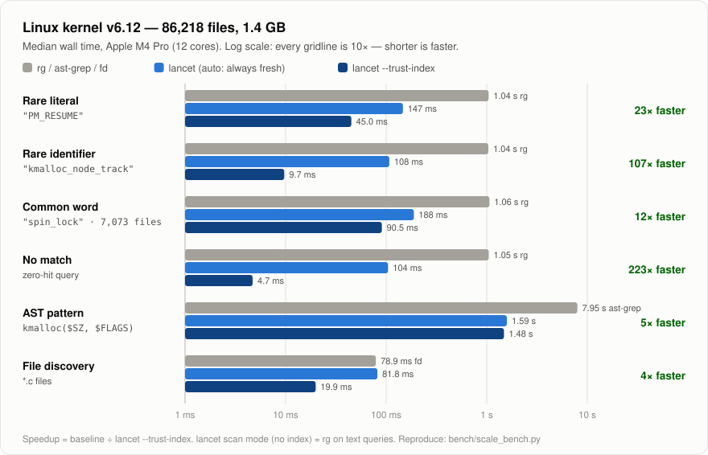
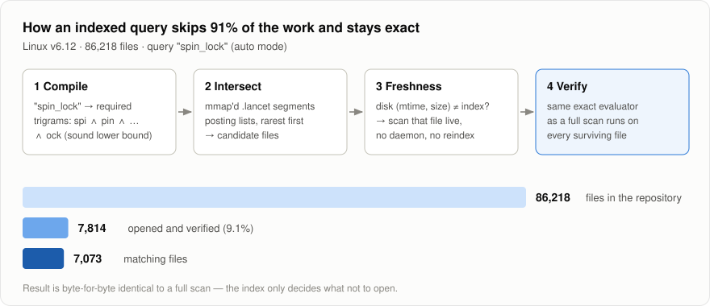
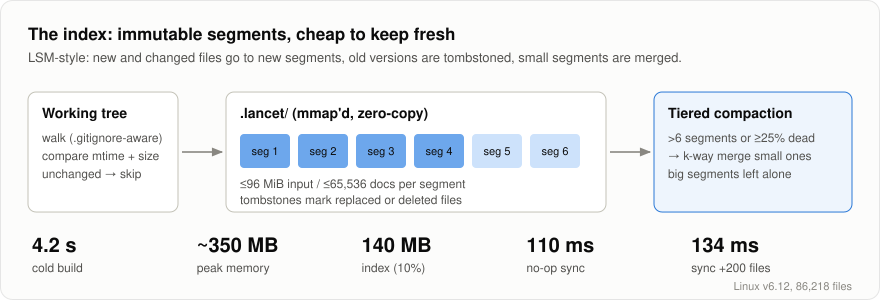

<div align="center">

# Lancet

**Find, read, and change code and documents — on one coordinate system, at index speed.**

[](https://github.com/CREE1116/lancet/actions/workflows/ci.yml)
[](#license)

[한국어](./README.ko.md) · [Query language](./docs/grammar.md) · [Agent instructions](./docs/agent-instructions.md) · [Benchmarks](#benchmarks)

</div>

<p align="center">
  
</p>

Lancet is a single Rust binary that replaces the `rg` + `fd` + `ast-grep` + `cat` + `pdftotext` chain with one tool that **shares an index and a coordinate system** across every step: discover files, search text and syntax, read exact ranges and symbols, and rewrite code — in source files, PDFs, spreadsheets, Korean HWP documents, and archives alike.

It is built for AI coding agents and the developers working beside them: structured JSON, hard token budgets, and **no silent approximations**.

---

## Two ideas

### 1 · Index speed, never a stale result

<p align="center"></p>

- The index **only decides what not to open.** Every candidate is checked by the same evaluator a full scan uses, so indexed results are identical to a scan — not "usually the same".
- Files edited since the last `lancet index` are detected by `(mtime, size)` and scanned live. **No watcher daemon, no reindex step, no stale hits.**
- When you *want* to trade freshness for speed, you say so explicitly: `--trust-index` answers straight from the index (5–90 ms on the Linux kernel).

### 2 · One coordinate system: find → read → change

<p align="center"></p>

- A search hit at line 42 is line 42 in `lancet read` — even inside a `.pdf`, `.xlsx`, `.hwp`, or `bundle.zip!node.log`, because search and read run the **same in-process extraction**.
- `read --symbol`, `outline`, `refs`, and `ast` all resolve the same Tree-sitter spans, so an agent never guesses where a function ends.
- `lancet edit` changes the exact lines `read` showed. Pass the `rev` that `read` reported and the edit refuses to run if the file changed in between; edits that add syntax errors are refused too.
- Rewrites and edits are dry-run diffs by default and land atomically with `--apply`; the next query already sees them.

---

## Quick start

```bash
cargo install --git https://github.com/CREE1116/lancet      # Rust 1.89+
lancet index .                                              # optional: build the .lancet index once
```

```bash
lancet fd --tree --max-depth 2 .                            # orient
lancet 'near("gradient", "clip", 30) in function' src       # search: boolean, proximity, fuzzy, AST scope
lancet read src/search.rs --symbol execute_one              # read one symbol, doc comments included
lancet refs SearchOptions src                               # definitions + references, comments/strings excluded
lancet ast '$X.unwrap()' src --lang rs --rewrite '$X?'      # preview a structural rewrite …
lancet ast '$X.unwrap()' src --lang rs --rewrite '$X?' --apply   # … and apply it atomically
lancet edit src/search.rs --symbol execute_one --with-file new.rs --rev <REV> --apply  # edit by read's coordinates
```

## Commands

| Command | What it does |
|---|---|
| `lancet <QUERY> [PATH]` | `AND` / `OR` / `NOT`, `near` / `before`, `fuzzy("term", k)`, `regex(...)`, `in function`, `symbol(...)`, pipes like `\| expand parent \| limit 5 \| budget tokens:1500` — see the [query language](./docs/grammar.md) |
| `lancet fd` | `.gitignore`-aware file & folder finder, `--tree`, size / recency filters, `--trust-index` lookups |
| `lancet ast` | Tree-sitter structural search & `--rewrite` (`$X`, `$_`, `$$$ARGS`) across **24 languages** |
| `lancet read` | Exact line ranges, `--symbol`, PDF/PPTX `--page`, spreadsheet `--sheet --rows --cols`, `archive.zip!entry`, `--budget-tokens` with resume cursors |
| `lancet edit` | Replace / delete / insert lines addressed like `read` (`--lines`, `--symbol`, or many hunks at once with `--edits`); a locked compare-and-swap on `--rev`, so concurrent agents never overwrite each other; refuses a net increase in syntax errors; dry-run unless `--apply` |
| `lancet outline` | Declaration skeletons, Markdown headings, workbook schemas, archive manifests |
| `lancet refs` | Index-accelerated `[def]` / `[ref]` lookup that skips comments and string literals |
| `lancet batch` | Many queries over one shared index open and directory walk |
| `lancet index` · `status` · `explain` | Build / update the index, inspect it, see which trigrams a query needs |

**AST languages:** Rust, Python, JavaScript, TypeScript, TSX, Go, C, C++, Zig, Java, C#, Kotlin, Scala, Swift, Ruby, PHP, Bash, Lua, HCL, HTML, CSS, JSON, YAML, TOML.
**Documents & archives** (default `adapters` feature): `.pdf`, `.docx`, `.pptx`, `.odt`, `.hwp` (5.0), `.hwpx`, `.epub`, `.xlsx`, `.xls`, `.xlsm`, `.xlsb`, `.ods`, `.zip`, `.tar`, `.gz`, `.tgz` — extracted in-process with 16 MiB bomb caps, plus opt-in `--ocr`.

---

## Benchmarks

The chart at the top is the Linux kernel v6.12 (86,218 files, 1.4 GB) on an Apple M4 Pro, reproducible with [`bench/scale_bench.py`](./bench/scale_bench.py) and redrawn by [`bench/readme_figures.py`](./bench/readme_figures.py). Without an index (`scan` mode) lancet runs at ripgrep's speed on text; the index is where the multiples come from.

<details>
<summary><b>Crate-source corpus (28,352 files, 452.6 MiB) — search, discovery, AST, documents</b></summary>

Reproducible via [`bench/run_bench.py`](./bench/run_bench.py), [`bench/bench_competitors.py`](./bench/bench_competitors.py), and [`bench/official_suite.sh`](./bench/official_suite.sh). Cold index build **1.17 s** (36.3 MiB, 8.0% of corpus); no-op sync **64.6 ms**.

**Text search** (`lancet` vs `ripgrep 15.2.0`)

| Query | `rg` | lancet scan | lancet auto | lancet `--trust-index` |
|---|---:|---:|---:|---:|
| Rare literal (`ThreadPoolBuilder`, 32 hits) | 307.7 ms | 310.6 ms | **60.5 ms (5.1×)** | **5.1 ms (60.3×)** |
| Medium literal (`unwrap_or_else`, 582 hits) | 311.3 ms | 314.6 ms | **65.4 ms (4.8×)** | **13.0 ms (23.9×)** |
| Boolean (`"unsafe" AND "transmute" NOT "miri"`) | 469.8 ms¹ | **304.8 ms** | **62.6 ms (7.5×)** | **10.1 ms (46.5×)** |
| Anchored regex (`pub unsafe fn \w+\(`) | 307.4 ms | 317.9 ms | **80.5 ms (3.8×)** | **26.9 ms (11.4×)** |
| Proximity (`near("unsafe", "transmute", 15)`) | *unsupported* | 307.1 ms | **65.9 ms** | **13.6 ms** |
| Typo fuzzy (`fuzzy("transmte", 1)`) | *unsupported* | 334.7 ms | **156.7 ms** | **107.4 ms** |
| Shared 6-query batch (`lancet batch`) | ~1,850 ms | 1,570.6 ms | **93.1 ms** | **30.7 ms (5.1 ms/q)** |

*¹ `rg` needs two passes for a file-level `AND`.*

**File discovery** (`lancet fd` vs `fd 10.5.2`, `rg --files`, `find`)

| Workload | `find` | `rg --files` | `fd` | lancet fd | lancet fd `--trust-index` |
|---|---:|---:|---:|---:|---:|
| List all files (28,352) | 176.0 ms | 47.5 ms | 49.8 ms | 60.6 ms | **14.4 ms (3.5×)** |
| Extension + name (`-e toml -p Cargo`) | — | — | 47.1 ms | 52.1 ms | **6.6 ms (7.1×)** |
| Size filter (≥ 100 KiB, 637 files) | 169.1 ms | — | 65.4 ms | **53.3 ms** | **5.6 ms (11.7×)** |

**Structural search** (`lancet ast` vs `ast-grep 0.51.3`)

| Rust pattern | `ast-grep` | lancet scan | lancet auto | lancet `--trust-index` |
|---|---:|---:|---:|---:|
| `std::mem::transmute($X)` (19 hits) | 1,764.7 ms | **251.1 ms (7.0×)** | **176.6 ms (10.0×)** | **95.3 ms (18.5×)** |
| `$X.unwrap_or_else($F)` (963 hits) | 1,649.2 ms | **268.6 ms (6.1×)** | **245.7 ms (6.7×)** | **153.0 ms (10.8×)** |
| `unreachable!($$$ARGS)` (1,893 hits) | 1,782.2 ms | **484.8 ms (3.7×)** | **526.7 ms (3.4×)** | **343.3 ms (5.2×)** |
| `ThreadPoolBuilder::new()` (75 hits) | 1,716.7 ms | **241.5 ms (7.1×)** | **65.2 ms (26.3×)** | **13.9 ms (123.5×)** |

**Documents & archives** (`lancet` vs `ripgrep-all 0.10.10`, 120 mixed files)

| Format & query | `rga` cold | `rga` cached | lancet scan | lancet auto | lancet `--trust-index` |
|---|---:|---:|---:|---:|---:|
| PDF (`QUARTERLY_REVENUE_ANOMALY`) | 263.5 ms | 67.3 ms | **10.6 ms** | **6.9 ms** | **3.4 ms** |
| DOCX (`SLA_INDEMNITY_CLAUSE`) | 262.0 ms | 67.5 ms | **10.7 ms** | **7.6 ms** | **4.1 ms** |
| XLSX (`H100_CLUSTER_CAPEX`) | *0 hits* | *0 hits* | **11.3 ms** | **7.5 ms** | **3.6 ms** |
| ZIP logs (`RAFT_QUORUM_STALL`) | 274.8 ms | 67.3 ms | **12.2 ms** | **7.1 ms** | **3.5 ms** |
| HWPX (`국가클라우드보안인증검토`) | *0 hits* | *0 hits* | **11.2 ms** | **8.1 ms** | **3.7 ms** |

</details>

---

## How the index works

<p align="center"></p>

1. **Sound trigram lower bounds.** Queries and regex HIRs compile to a boolean trigram formula (`Req`) that every match must satisfy. Posting lists are intersected rarest-first; ultra-common trigrams (> 85% of files) are skipped. The formula is conservative, so the index can narrow but never drop a match.
2. **Fuzzy search on the index.** By the q-gram lemma, a word with `|G|` trigrams at edit distance `k` keeps at least `|G| − 3k` of them (`|G| − k` for Hangul syllables), so `fuzzy(...)` runs as a `k`-of-`n` posting count instead of a full scan.
3. **Three-stage AST matching.** Identifier literals in the pattern (a) prune files through the index, (b) gate Tree-sitter behind a SIMD `memmem` check, and (c) skip every subtree that does not contain them, before matching a precompiled `u16 kind_id` pattern tree.
4. **Unicode case orbits.** Case-equivalent characters (`k`, `K`, Kelvin `K`) fold to one representative in both index and evaluator; ASCII literals use `memchr2` dual-case scans instead of regex automata.
5. **Zero-copy `LANCET04` segments.** Opening the index reads a 40-byte header of an `mmap`'d file; lookups allocate nothing, and line numbers are computed only for byte spans that actually match.
6. **LSM upkeep with bounded memory.** Changed files go to new immutable segments and old versions are tombstoned; tiered compaction merges small segments. Build buffers are reused across segments, keeping a Linux-kernel cold build near 350 MB.

**Exactness guarantees.** Malformed queries, unknown flags, and unparseable patterns fail with exact diagnostics instead of a best guess. `--rewrite` and `edit` never touch a file without `--apply`, `--apply` refuses to combine with `--limit` (no partial rewrites), and `edit --rev` refuses to write over a file that changed since it was read. Freshness compares mtime, size, ctime and inode; Windows exposes no ctime or inode through the standard library, so there an edit that keeps the size *and* restores the old mtime is only caught by `lancet index` or `--no-index`.

---

## Why `lancet read` instead of `cat`, `sed`, or a built-in `Read`?

- **Same line numbers as search, in every format** — PDFs, Office files, HWP, and archive entries included.
- **Semantic slices** — `--symbol`, `--page`, `--sheet --rows --cols` return exactly the unit you asked for in one call.
- **Hard token budgets** — `--budget-tokens 800` stops at the boundary and returns `next_line` to resume.
- **No temp files, no external converters** — containers are opened in memory under 16 MiB extraction caps.

## Using Lancet with AI agents

Drop [`docs/agent-instructions.md`](./docs/agent-instructions.md) into your `AGENTS.md`, `CLAUDE.md`, or system rules. Agents then replace multi-tool shell chains with structured, token-budgeted `lancet` calls.

## Installation options

```bash
cargo install --git https://github.com/CREE1116/lancet                          # full build
cargo install --git https://github.com/CREE1116/lancet --no-default-features    # text/code only: no Tree-sitter, no document adapters
```

## License

Dual-licensed under either of [Apache License 2.0](./LICENSE-APACHE) or [MIT](./LICENSE-MIT), at your option.
