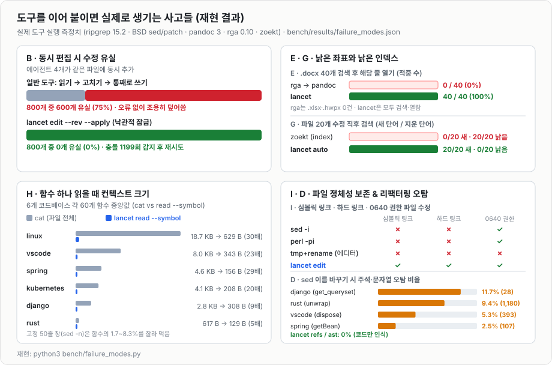
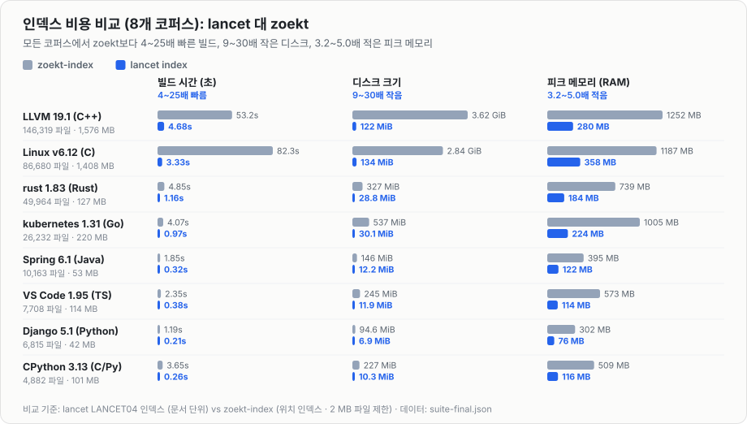
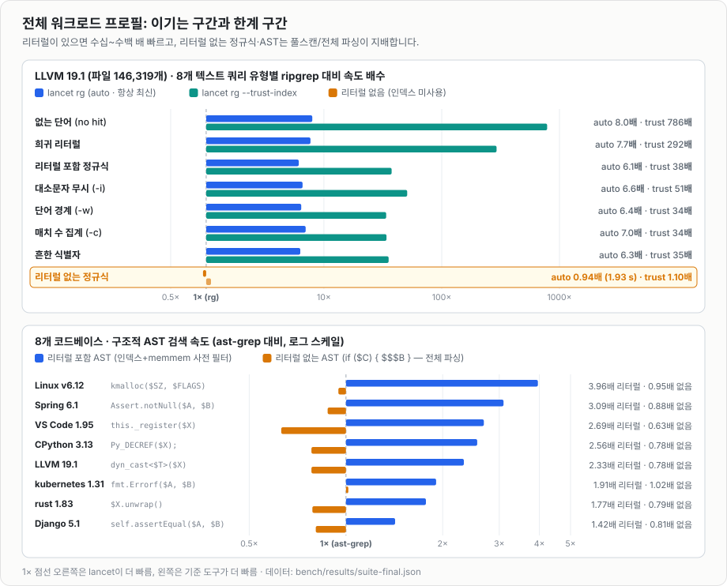

# 왜 에이전트에게 하나의 도구인가 — 근거

에이전트는 보통 여러 도구를 이어 붙여 일합니다. `rg`로 찾고, `cat`/`sed -n`으로 읽고, `sed -i`나
"파일 통째로 쓰기" 도구로 고치고, `patch`로 diff를 적용하고, 문서는 `pdftotext`/`pandoc`/`rga`로,
속도가 필요하면 코드 인덱스를 씁니다. 도구 하나하나는 훌륭합니다. 사고는 **도구 사이**에서 납니다.
좌표, 파일 목록, 바이너리 판정, 시점에 대한 생각이 서로 다르고, 어느 도구도 다른 에이전트가 같은
파일을 고치고 있다는 사실을 모릅니다.

이 문서는 그 사고들을 누구나 다시 돌려 볼 수 있는 숫자로 보여 주고, 각 설계 선택이 어떤 대안을
이겼는지 설명하며, lancet이 아직 지는 곳도 그대로 적습니다.

- 실패 시나리오: [`bench/failure_modes.py`](../bench/failure_modes.py) → `bench/results/failure_modes.json`
- 속도·정확성 스위트: [`bench/suite.py`](../bench/suite.py) → `bench/results/SUITE.md`
- ripgrep 호환성: [`bench/rg_parity.py`](../bench/rg_parity.py), [docs/rg-parity.md](./rg-parity.md)

---

## 1. 도구를 이어 붙이면 실제로 생기는 일

모든 행은 실제 도구를 실제로 돌린 결과입니다(macOS, ripgrep 15.2, BSD sed/patch, pandoc 3, rga 0.10, zoekt).

  

| # | 작업 | 도구 체인 | 실제로 일어난 일 | lancet |
|---|---|---|---|---|
| A | 검색 한 번으로 찾은 호출 두 곳 고치기 | `rg -n` → `sed -i 'Ns/…/'` 두 번 | 첫 수정이 두 줄을 늘려서 두 번째 수정이 **엉뚱한 줄을 덮어씀**. `sed`는 두 번 다 종료 코드 **0**. | `edit --edits`: 모든 구간이 원본 줄 번호 기준 → 정확. `--rev`로 순서대로 고치면 오래된 두 번째 수정은 `conflict`로 거부. |
| B | 에이전트 4개가 동시에 한 파일에 줄 추가 (200회) | 파일 읽기 → 고치기 → 통째로 쓰기 | 수정 800개 중 **600개 유실**(75%). 오류는 하나도 안 남. | `edit --rev --apply` + `conflict` 시 재시도: 800개 중 **유실 0**(충돌 1,199번을 감지하고 재시도). |
| C | 두 번째 파일이 그새 바뀐 2-파일 diff 적용 | `patch -p1` | 첫 파일은 **바뀌고** 둘째는 거부, `b.py.rej`가 남음 — 반쯤 적용된 리팩터링(종료 코드 1). | `patch --apply`: 모든 파일을 먼저 검증 → **아무것도 쓰지 않음**, `conflict`가 어느 hunk인지 알려 줌. |
| D | 식별자 이름 바꾸기 | `rg -l \| xargs sed -i 's/\bname\b/…/'` | **주석과 문자열 리터럴** 안의 출현까지 바꿈: 전체 출현의 0.3~11.7%(rust의 `unwrap` 1,180곳, Django의 `get_queryset` 28곳). 문자열이 바뀌면 동작이 바뀜. | `refs`·`ast --rewrite`는 코드만 봄(주석·문자열 제외). |
| E | `.docx`에서 단어를 찾고 그 줄 읽기 | `rga -n` → `pandoc -t plain \| sed -n Np` | 읽은 줄 40개 중 **0개**에 단어가 있음: rga는 자기 변환 결과로 줄을 세고, pandoc은 72열에서 줄바꿈하고 빈 줄을 넣음. rga는 `.xlsx`·`.hwpx`에서 **아무것도 못 찾음**. | 검색과 `read`가 같은 추출을 씀: **40개 중 40개**. `.xlsx`·`.hwpx`도 찾음. |
| G | 파일 20개를 고치고 바로 검색 | zoekt(인덱스) | 새 텍스트는 **0개** 파일, 지운 텍스트는 **20개** 파일에서 찾음 — 재인덱싱 전까지 완전히 낡은 결과. | auto 모드: 새 텍스트 **20개**, 지운 텍스트 **0개**. |
| H | 함수 하나 읽기 | `cat file` / `sed -n 'L,L+49p'` | `cat`은 코드베이스 6개에서 함수당 중앙값 **0.6~18.7 KB**(Linux 18.7 KB). 50줄 창은 함수의 **1.7~8.3%를 잘라 먹음**(왕복 한 번 더). | `read --symbol`: 중앙값 **129~629 B**, 항상 함수 전체와 문서 주석. |
| I | 심볼릭 링크·하드 링크·`0640` 권한 파일 고치기 | `perl -pi`, `sed -i`, 임시 파일+rename(에디터 도구) | 세 방식 모두 **하드 링크를 끊음**. 심볼릭 링크로 고치면 실패하거나(`sed`) **링크를 일반 파일로 바꿈**. 에디터 방식은 **0640 권한을 잃음**. | 심볼릭 링크 유지 + 대상 파일 수정, 하드 링크 공유 유지, 권한(가능하면 소유자·그룹까지) 유지. |
| F | "X가 들어 있는 파일은?" | `rg`, `git grep`, `ugrep`, `zoekt`, `fd \| xargs rg` | 도구마다 **파일 범위가 다름**: 숨김 파일, `.gitignore` 대 추적 파일, 바이너리 판정, zoekt의 2 MB 파일 크기 제한. 스위트에서 `git grep` 44,828 대 `rg` 44,826줄(Linux), zoekt 12,056 대 12,703(LLVM), 7 대 9(CPython). | 모든 명령이 탐색기 하나(ripgrep의 `ignore` 크레이트)와 바이너리 규칙 하나를 씀. `lancet rg` 출력은 ripgrep과 바이트 단위로 같음. |

공통점은 하나입니다. **각 단계가 다른 프로그램이 다른 시점에 만든 좌표·파일 목록·타임스탬프를 믿습니다.**
lancet은 그것들을 한 프로세스, 한 좌표계, "지금 이 파일"이라는 하나의 기준 안에 둡니다.

## 2. 에이전트에 맞춰 고친 게 아니라, 에이전트를 위해 만든 도구

에이전트는 터미널을 눈으로 훑지 못하고, 조금만 모호해도 재시도하고, 읽는 바이트마다 비용을 냅니다. 그래서:

- **구조화되고 결정적인 출력.** 모든 명령에 `--json`이 있고, 결과는 경로순으로 정렬돼 같은 쿼리는 실행할 때마다, 스레드 수와 무관하게 같은 바이트를 냅니다.
- **기계가 읽을 수 있는 정확한 실패.** 모르는 플래그, 잘못된 쿼리, 파싱할 수 없는 패턴은 추측하지 않고 바이트 위치와 함께 실패합니다. 종료 코드는 ripgrep과 같고(0 찾음, 1 없음, 2 오류), `conflict`는 별도 상태입니다.
- **이어지는 좌표.** 검색 결과의 줄은 `read`가 돌려주는 줄이고 `edit`가 고치는 줄입니다. 소스 파일, PDF, 스프레드시트, HWP, 압축 파일 내부 항목 모두 마찬가지입니다.
- **토큰 예산.** `| budget tokens:N`과 `read --budget-tokens`는 예산에서 멈추고 이어 읽을 커서를 돌려줍니다(시나리오 H).
- **대화형 프롬프트 없음, 안전한 기본값.** 모든 쓰기는 `--apply` 전까지 dry-run diff입니다.
- **모델이 이미 아는 형식.** `lancet rg`는 ripgrep의 플래그를 받고 ripgrep의 출력을 냅니다. `lancet patch`는 `git diff` 출력을 받습니다. `rg`와 diff로 학습된 모델은 흔한 작업에 새 언어를 배울 필요가 없습니다.

## 3. 에이전트 여러 개, 저장소 하나

"읽고, 고치고, 다시 쓰기"를 조율 없이 하면 유실(시나리오 B)이 기본 결과입니다. lancet의 규약은
낙관적 동시성 제어이고, HTTP의 `If-Match`와 같은 발상입니다.

1. `lancet read --json`이 파일의 **`rev`**(정확한 바이트의 내용 해시)를 돌려줍니다.
2. `lancet edit … --rev <REV> --apply`(또는 `ast --rewrite --apply`, `patch --apply`)는 파일에 배타 잠금을 걸고, 읽었던 그 파일이 맞는지(inode로 rename 교체 감지), `rev`가 여전히 같은지 확인한 뒤에 씁니다.
3. 경쟁에서 진 쪽은 **`conflict`**(종료 코드 2)를 받고 아무것도 쓰지 않습니다. 다시 읽고, 새 내용에 자기 변경을 다시 적용하고, 새 `rev`로 재시도합니다.
4. 성공한 편집은 **`rev_after`**를 돌려주므로, 한 에이전트는 다시 읽지 않고 편집을 이어 갈 수 있습니다. 한 파일의 여러 변경은 **`--edits` 한 번**에 넣습니다(모든 구간이 원본 좌표, 전부 적용되거나 아무것도 안 됨).
5. `patch`는 쓰기 전에 모든 파일을 검증하고, 쓰는 도중 다른 쓰기가 이기면 이미 바꾼 파일을 되돌립니다.

테스트는 한 리비전에 작성자 8개를 경쟁시켜 정확히 하나만 이기도록 요구합니다. 잠금을 빼면 그 테스트는
10번 중 10번 실패합니다. lancet을 거치지 않는 작성자(에디터를 쓰는 사람)는 직렬화되지 않지만,
확인 전에 그가 바꾼 내용은 여전히 `conflict`를 일으킵니다.

## 4. 소유권, 버전, 파일 정체성

- **내용 리비전(`rev`).** 파일 바이트의 XXH3-64 해시입니다(변경 감지용이며 암호학적 해시가 아님). `read`, `ast`, `edit`가 알려 주며, 추출된 문서와 압축 파일 내부 항목에는 없습니다. 그것들은 다시 쓸 바이트 범위가 없어 읽기 전용입니다.
- **인덱스 버전.** 디스크 형식에 버전이 있습니다(`LANCET04`). 이전 버전이거나 손상된 인덱스는 `lancet index`가 자동으로 새로 빌드합니다. 인덱스는 캐시일 뿐 진실의 원천이 아닙니다.
- **고친 파일은 같은 파일로 남습니다**(시나리오 I). 심볼릭 링크는 따라가서 유지하고, 하드 링크가 여럿인 파일은 제자리에 다시 쓰고, 권한은 유지하며, OS가 허락하는 범위에서 소유자와 그룹도 유지합니다. 그 밖에는 임시 파일에 쓰고 fsync한 뒤 원본 위로 rename하고 디렉터리까지 fsync하므로, 읽는 쪽도, 크래시 뒤의 파일도 옛 내용이나 새 내용 중 하나만 갖고 섞인 상태는 없습니다. 다만 두 경로는 crash-atomic이 아닌 best-effort입니다. 하드 링크 파일의 제자리 쓰기, 그리고 여러 파일에 걸친 `patch` 되돌리기입니다.
- **mtime만이 아닌 신선도.** "인덱싱 이후 바뀌지 않음"은 mtime, 크기, ctime, inode가 모두 같고, 동기화 시점의 파일시스템 타임스탬프 해상도 안에서 쓰이지 않았을 때만 성립합니다("racy git"). ctime은 mtime을 되돌리는 도구(`cp -p`, `tar -x`, `rsync -t`)를 잡아냅니다. Windows 표준 라이브러리는 ctime과 inode를 주지 않아서, 크기가 같고 mtime까지 되돌린 수정은 재인덱싱해야만 잡힙니다.

## 5. 왜 파일 범위에 문서와 압축 파일까지 넣었나

에이전트는 소스 트리에서만 일하지 않습니다. 명세는 PDF, 계약서는 DOCX, 예산은 XLSX, 한국 공공 문서는
HWP/HWPX이고, 로그는 압축돼서 옵니다. 체인으로 하면 형식마다 변환기가 하나씩 늘고, 변환기마다 "줄"의
정의가 다릅니다(시나리오 E: rga → pandoc을 거치며 좌표 40개 중 0개가 살아남음). lancet은 이것들을
프로세스 안에서 추출하고, 검색·`read`·`outline`·인덱스가 그 파이프라인 하나를 공유합니다. 상한도
엄격합니다(파일당 추출 텍스트 16 MiB, zip 폭탄 방어, 임시 파일 없음, 외부 프로그램 없음).

`lancet rg`는 기본적으로 ripgrep처럼 동작해서 문서를 바이너리로 취급하고, `--docs`를 줄 때만 문서 안을
검색합니다. 그래서 `rg`를 그대로 대신해도 출력이 달라지지 않습니다.

## 6. 설계 선택과 그것이 이긴 대안

| 선택 | 대안 | 이유(측정) |
|---|---|---|
| **문서 단위 트라이그램 인덱스 + 정확한 재검증** | 위치 인덱스(zoekt), 인덱스 없음(ripgrep) | 코드베이스 8개에서 인덱스는 원본의 8~23%, zoekt는 2.1~2.8배(9~30배 작음). 빌드는 4~25배 빠르고 피크 메모리는 3.2~5.0배 적음. 모든 후보를 풀스캔과 같은 평가기로 다시 확인하므로 결과가 스캔과 같음(무작위 코퍼스 × 무작위 수정 × 무작위 쿼리 차등 퍼징으로 검증). |
| **불변 mmap 세그먼트 + 계층형 컴팩션(LSM)** | 큰 인덱스 하나를 다시 쓰기 | 증분 동기화는 바뀐 파일만 건드림. 빌드 버퍼를 세그먼트 사이에 재사용해 Linux 콜드 빌드 피크 메모리를 1.3 GiB에서 약 350 MB로 줄임. |
| **데몬 없는 신선도(mtime·크기·ctime·inode·racy 창)** | 파일 감시 데몬, macOS FSEvents 기록 | 계속 살려 두거나 어긋날 프로세스가 없음. FSEvents는 구현했다가 기각함: 한 경로의 이벤트를 이전 레코드에 합쳐서, 동기화 직후의 변경이 빠질 수 있었음 — 정확성 구멍. |
| **명시적 선택인 `--trust-index`** | 신선도 확인을 조용히 생략 | 신선도와 속도를 바꾸는 건 호출하는 쪽이 알고 하는 선택(zoekt는 항상 그렇게 함 — 시나리오 G). |
| **ripgrep 호환 입구** | 자체 쿼리 언어만 | ripgrep과 같은 정규식 엔진, 무시 규칙, 타입 표. 까다로운 케이스 67개와 Linux·LLVM 전체 쿼리가 바이트 단위로 같음. DSL은 `rg`로 표현할 수 없는 것(`near`, `fuzzy`, `in function`, 파이프)을 위해 남김. |
| **리터럴 프리필터를 쓰는 Tree-sitter AST** | 모든 파일 파싱(ast-grep) | 패턴의 식별자로 인덱스에서 파일을, `memmem`으로 서브트리를 미리 거름. `$$$` 매칭은 메모이제이션과 노드당 시도 예산으로 묶여서, 인자 200개 호출의 `f($$$A, $$$B, $$$C, $$$D, x)`가 몇 분이 아니라 약 0.03초. 정말 병적인 패턴은 멈추지 않고 경고를 내며 끝남. |
| **쓰기 경로 하나(`src/change.rs`)** | 명령마다 제각각 쓰기 | `edit`, `write`, `patch`, `rename`, `ast --rewrite`가 리비전 확인, 잠금, 파일 정체성 규칙, 구문 검사(Tree-sitter 오류가 순증가하면 거부), 여러 파일을 전부 쓰거나 하나도 안 쓰는 규칙을 공유. |

## 7. lancet이 이기지 못하는 곳

- **리터럴 없는 정규식**(`\w+\s*=\s*\d{6,}`): 인덱스가 걸러 줄 게 없음. ripgrep과 같은 속도이거나, 작은 트리에서 최대 약 1.4배 느림.
- **리터럴 없는 구조 AST 패턴**(`if ($C) { $$$B }`): 모든 파일을 파싱해야 함. ast-grep 속도의 0.6~1.0배. 의미도 다름: lancet은 모양 그대로만 매치하고(`else`가 붙은 `if`는 다른 모양), ast-grep은 `if … else`에도 매치함.
- **`refs`는 의미 분석이 아닌 어휘 분석**: 타입 해석이 없어 다른 스코프의 같은 이름도 포함됨. 찾는 도구이지 이름 바꾸기 엔진이 아님.
- **auto 모드는 신선도를 위해 모든 파일을 stat함**: 파일 8.7만 개에 약 100 ms. 수백만 개짜리 모노레포에서는 더 걸림(그럴 땐 알고서 `--trust-index`).
- **바이너리 크기** 약 40 MB(문법 24개와 문서 어댑터 포함). `--no-default-features`로 텍스트·코드 전용 바이너리를 만들 수 있음.

## 8. 벤치마크 요약

Apple M4 Pro, 웜 캐시, 5회 중앙값(hyperfine 2, 출력은 파이프). 전체 표: `bench/results/SUITE.md`.

  

  

| 코퍼스 | 파일 | lancet 인덱스 (빌드 · 크기 · 피크) | zoekt 인덱스 (빌드 · 크기 · 피크) | 텍스트 auto vs rg | 텍스트 trust vs rg | 리터럴 AST vs ast-grep |
|---|---:|---|---|---|---|---|
| Linux v6.12 (C) | 86,680 | 3.3 s · 134 MB · 358 MB | 82 s · 2.9 GB · 1.2 GB | 5.8~7.5배 | 13~403배 | 4.0배 |
| LLVM 19.1 (C++) | 146,319 | 4.7 s · 122 MB · 280 MB | 53 s · 3.7 GB · 1.3 GB | 6.1~8.0배 | 34~786배 | 2.3배 |
| rust 1.83 (Rust) | 49,964 | 1.2 s · 29 MB · 184 MB | 4.9 s · 327 MB · 739 MB | 1.5~9.6배 | 2~273배 | 1.8배 |
| kubernetes 1.31 (Go) | 26,232 | 1.0 s · 30 MB · 224 MB | 4.1 s · 537 MB · 1.0 GB | 3.5~5.8배 | 9~210배 | 1.9배 |
| VS Code 1.95 (TS) | 7,708 | 0.4 s · 12 MB · 114 MB | 2.4 s · 245 MB · 573 MB | 2.1~3.9배 | 4~63배 | 2.7배 |
| Django 5.1 (Python) | 6,815 | 0.2 s · 7 MB · 76 MB | 1.2 s · 95 MB · 302 MB | 2.4~2.9배 | 10~60배 | 1.4배 |
| CPython 3.13 (C/Python) | 4,882 | 0.3 s · 10 MB · 116 MB | 3.7 s · 227 MB · 509 MB | 3.0~5.4배 | 5~30배 | 2.6배 |
| Spring 6.1 (Java) | 10,163 | 0.3 s · 12 MB · 122 MB | 1.9 s · 146 MB · 395 MB | 2.9~5.3배 | 6~95배 | 3.1배 |

"텍스트"는 희귀·흔한 리터럴, `-i`, `-w`, 리터럴 포함 정규식, 없는 단어, `-c`를 말합니다. lancet의 모든
출력(auto, trust, 인덱스 없음)을 ripgrep과 바이트 단위로 대조했습니다. `--trust-index`는 바뀐 파일을
확인하지 않습니다. zoekt가 항상 하는 것과 같은 선택이고, zoekt의 쿼리 시간도 비슷한 범위입니다.

## 9. 진지하게 받아들인 비판

| 비판 | 한 일 |
|---|---|
| "자체 DSL은 에이전트의 재시도 비용을 부른다." | 흔한 작업이 모델이 이미 아는 형식을 쓰도록 `lancet rg`(ripgrep의 CLI와 출력)와 `lancet patch`(unified diff)를 추가. |
| "여러 번 고치면 줄 좌표가 밀리고, 원자성이 없다." | `--edits`(모든 구간이 원본 좌표, 전부 아니면 아무것도), `rev`/`rev_after`, compare-and-swap 쓰기, `patch`의 사전 검증과 되돌리기. |
| "`(mtime, size)`는 같은 크기 수정, 되돌린 mtime, 낮은 타임스탬프 해상도를 놓친다." | ctime + inode + racy 창. 예전 규칙에서 실패하는 회귀 테스트와 차등 퍼징. |
| "데몬이 없으면 쿼리마다 전체 stat이 돈다." | 측정함(8.7만 파일에 약 100 ms). 기록 기반 지름길을 만들었다가 정확성 때문에 기각. `--trust-index`가 명시적인 빠른 길. |
| "리터럴 없는 AST 패턴은 벤치마크가 없다." | 이제 모든 코퍼스에 포함(7절에 진 결과). 최악의 `$$$` 백트래킹은 메모이제이션과 시도 예산으로 묶음. |
| "구문 수준 `refs`는 리팩터링을 오도한다." | `refs`는 어휘 분석으로 명시하고 교차 파일 `refs` 기반 이름 바꾸기는 넣지 않았습니다. 대신 단일 파일 `lancet rename`은 언어별 스코프 해석 + 재해석 섀도잉/캡처 검증을 통과할 때만 실행하고 모호하면 거절합니다. |
| "빌드와 설치가 무겁다." | 해결: 릴리스마다 macOS, Linux(glibc, 정적 musl), Windows용 바이너리를 올리고 Homebrew, `install.sh`, `install.ps1`, `cargo binstall`로 설치. `--no-default-features`로 빌드하면 텍스트·코드 전용 약 4 MB 바이너리. |
| "에이전트 수준 벤치마크가 없다." | 남은 일: 다음 단계는 실제 모델로 재는 턴 수·토큰·패치 성공률. |
