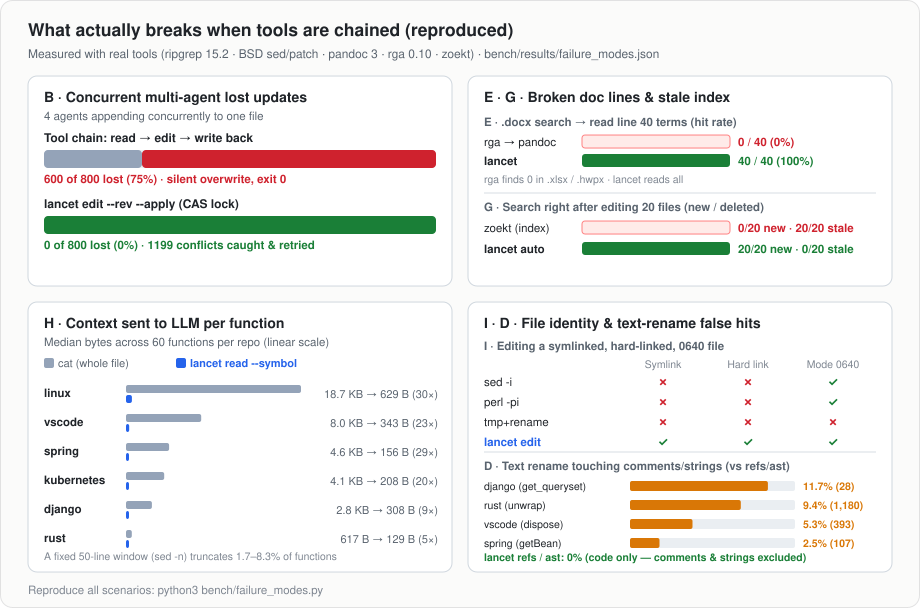
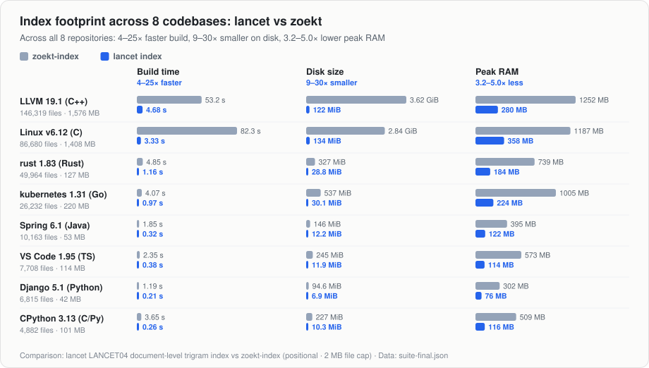

# Why one tool for agents — the evidence

Lancet replaces a chain of tools an agent usually strings together — `rg` to find,
`cat`/`sed -n` to read, `sed -i` or a write-the-whole-file tool to change, `patch` to apply
diffs, `pdftotext`/`pandoc`/`rga` for documents, a code index for speed. Each tool is good on
its own. The failures happen **between** them: they disagree about coordinates, files,
binary data and time, and none of them knows another agent is editing the same file.

This page shows those failures with numbers anyone can regenerate, explains each design
choice and the alternative it beat, and lists where lancet still loses.

- Failure scenarios: [`bench/failure_modes.py`](../bench/failure_modes.py) → `bench/results/failure_modes.json`
- Speed/correctness suite: [`bench/suite.py`](../bench/suite.py) → `bench/results/SUITE.md`
- ripgrep parity: [`bench/rg_parity.py`](../bench/rg_parity.py), [docs/rg-parity.md](./rg-parity.md)

---

## 1. What goes wrong when tools are chained

Every row is a real run of the real tools (macOS, ripgrep 15.2, BSD sed/patch, pandoc 3,
rga 0.10, zoekt), not a thought experiment.

  

| # | Task | Tool chain | What happened | lancet |
|---|---|---|---|---|
| A | Change two call sites found by one search | `rg -n` → `sed -i 'Ns/…/'` twice | The first edit added two lines, so the second edit **overwrote the wrong line**. Both `sed` calls exited **0**. | `edit --edits`: all hunks use the original line numbers → correct. Sequential edits with `--rev`: the stale second edit is refused (`conflict`). |
| B | 4 agents append to one file at the same time (200 trials) | read file → modify → write it back | **600 of 800 updates lost** (75%). Nothing reported an error. | `edit --rev --apply` + retry on `conflict`: **0 of 800 lost** (1,199 conflicts detected and retried). |
| C | Apply a 2-file diff where the 2nd file changed meanwhile | `patch -p1` | File 1 **changed**, file 2 rejected, `b.py.rej` left behind: a half-applied refactor (exit 1). | `patch --apply`: every file verified first → **nothing written**, `conflict` names the hunk. |
| D | Rename an identifier | `rg -l \| xargs sed -i 's/\bname\b/…/'` | Also rewrites occurrences in **comments and string literals**: 0.3–11.7% of all occurrences (e.g. `unwrap` in rust-lang/rust: 1,180; `get_queryset` in Django: 28). Changing strings changes behaviour. | `refs` / `ast --rewrite` see code only (comments and strings excluded). |
| E | Find a term in a `.docx`, then read that line | `rga -n` → `pandoc -t plain \| sed -n Np` | **0 of 40** lines read contained the term: rga numbers lines of its own conversion, pandoc wraps at 72 columns and adds blank lines. rga finds **nothing** in `.xlsx` and `.hwpx`. | Search and `read` share one extraction: **40 of 40**; `.xlsx`/`.hwpx` found. |
| G | Edit 20 files, search right away | zoekt (index) | Finds the new text in **0** files and the deleted text in **20** — fully stale until re-indexed. | auto mode: new text in **20**, deleted text in **0**. |
| H | Read one function | `cat file` / `sed -n 'L,L+49p'` | `cat` costs a median **0.6–18.7 KB** per function across 6 codebases (18.7 KB in Linux); a 50-line window **truncates 1.7–8.3%** of functions (another round trip). | `read --symbol`: median **129–629 B**, always the whole function plus its doc comment. |
| I | Edit a symlinked, hard-linked, `0640` file | `perl -pi`, `sed -i`, tmp-file + rename (editor tools) | perl/sed/editor-style writes **break the hard link**; editing through a symlink either fails (`sed`) or **replaces the link with a regular file**; the editor-style write **drops the 0640 mode**. | Symlink kept and its target edited, hard link still shared, mode (and owner/group where allowed) kept. |
| F | Ask "which files contain X?" | `rg`, `git grep`, `ugrep`, `zoekt`, `fd \| xargs rg` | The tools **disagree** on the file set: hidden files, `.gitignore` vs tracked files, binary detection, zoekt's 2 MB file limit. In the suite: `git grep` 44,828 vs `rg` 44,826 lines (Linux), zoekt 12,056 vs 12,703 (LLVM), 7 vs 9 (CPython). | One walker (ripgrep's `ignore` crate) and one binary rule for every command; `lancet rg` output is byte-identical to ripgrep's. |

The common thread: **each step trusts coordinates, file lists or timestamps produced by a
different program at a different moment.** Lancet keeps them in one process, one coordinate
system and one notion of "the current file".

## 2. Built for agents, not adapted to them

An agent can't eyeball a terminal, retries on any ambiguity, and pays for every byte it
reads. So lancet is designed around that:

- **Structured, deterministic output.** Every command has `--json`; results are sorted by
  path so the same query gives the same bytes on every run and thread count.
- **Exact, machine-readable failures.** Unknown flags, bad queries and unparseable patterns
  fail with a byte offset instead of a best guess. Exit codes follow ripgrep: 0 match,
  1 none, 2 error; `conflict` is its own status.
- **Coordinates that chain.** A search hit's line is the line `read` returns and the line
  `edit` changes — in source files, PDFs, spreadsheets, HWP and archive entries alike.
- **Token budgets.** `| budget tokens:N` and `read --budget-tokens` stop at the budget and
  return a resume cursor (scenario H).
- **No interactive prompts, safe defaults.** Every write is a dry-run diff until `--apply`.
- **Formats the model already knows.** `lancet rg` takes ripgrep's flags and prints
  ripgrep's output; `lancet patch` takes `git diff` output. A model trained on `rg` and
  diffs doesn't need to learn a new language for the common path.

## 3. Several agents, one repository

Lost updates (scenario B) are the default outcome of "read, change, write back" with no
coordination. Lancet's protocol is optimistic concurrency, the same idea as `If-Match` in
HTTP:

1. `lancet read --json` returns the file's **`rev`** (a content hash of the exact bytes).
2. `lancet edit … --rev <REV> --apply` (or `ast --rewrite --apply`, or `patch --apply`)
   takes an exclusive lock on the file, checks that it is still the file that was read
   (inode, so a rename-over is detected) and that its `rev` still matches, then writes.
3. The loser of a race gets **`conflict`** (exit 2) and nothing is written. It re-reads,
   re-applies its change to the new content and retries with the new `rev`.
4. Every successful edit returns **`rev_after`**, so one agent can chain edits without
   re-reading; several changes to one file go in **one `--edits` call** (all hunks in the
   original coordinates, applied together or not at all).
5. `patch` verifies every file before writing any, and if a concurrent writer wins while it
   writes, restores the files it already changed.

The test suite races 8 writers on one revision and requires exactly one winner; with the
lock removed that test fails 10 out of 10 runs. Writers that bypass lancet (a human in an
editor) are not serialised, but a change they made before the check still yields
`conflict`.

## 4. Ownership, versions and file identity

- **Content revisions (`rev`).** 64-bit FNV-1a of the file's bytes; reported by `read`,
  `ast` and `edit`, absent for extracted documents and archive entries (those are
  read-only — there is no byte range to write back to).
- **Index versions.** The on-disk format is versioned (`LANCET04`). An index from an older
  version, or a damaged one, is rebuilt automatically by `lancet index` — it is a cache,
  never a source of truth.
- **The edited file stays the same file** (scenario I): symlinks are followed and kept,
  files with several hard links are rewritten in place, permissions are kept, and owner and
  group too where the OS allows. Everything else is written to a temp file and renamed, so a
  reader sees the old or the new content, never a mix.
- **Freshness, not just mtime.** A file is "unchanged since indexing" only if mtime, size,
  ctime *and* inode all match and it was not written within the filesystem's timestamp
  granularity of the sync ("racy git"). ctime catches tools that restore mtime (`cp -p`,
  `tar -x`, `rsync -t`). On Windows the standard library exposes no ctime/inode, so there an
  edit that keeps the size and restores the old mtime is only caught by re-indexing.

## 5. Why the file scope includes documents and archives

Agents don't only work in source trees. Specs are PDFs, contracts are DOCX, budgets are
XLSX, Korean public-sector documents are HWP/HWPX, logs arrive zipped. With a chain, each
format needs another converter, and each converter has its own notion of a "line"
(scenario E: 0/40 coordinates survived rga → pandoc). Lancet extracts them in-process with
one pipeline that search, `read`, `outline` and the index all share, under hard caps
(16 MiB of extracted text per file, zip-bomb safe, no temp files, no external programs).

`lancet rg` keeps ripgrep's behaviour by default — documents are binary there — and searches
inside them only with `--docs`, so a drop-in `rg` replacement never changes its output.

## 6. Design choices and what they beat

| Choice | Alternative | Why (measured) |
|---|---|---|
| **Document-level trigram index + exact re-verification** | Positional index (zoekt); no index (ripgrep) | Across 8 codebases the index is 8–23% of the corpus vs zoekt's 2.1–2.8× (9–30× smaller), builds 4–25× faster with 3.2–5.0× less peak memory. Every candidate is re-checked by the full-scan evaluator, so results equal a scan (differential fuzzing: random corpora × random edits × random queries). |
| **Immutable mmap segments + tiered compaction (LSM)** | Rewrite one big index | Incremental sync touches only changed files; build buffers are reused across segments — Linux cold build peak memory went from 1.3 GiB to ~350 MB. |
| **Daemonless freshness (mtime, size, ctime, inode, racy window)** | File watcher daemon; macOS FSEvents history | No process to keep alive or to get out of sync. FSEvents was implemented and rejected: it coalesces a path's events into an earlier record, so a change right after the sync cursor could be missing — a correctness hole. |
| **`--trust-index` as an explicit choice** | Silently skipping the freshness check | Speed for freshness is a trade the caller makes knowingly (zoekt makes it always — scenario G). |
| **ripgrep-compatible front end** | Only a custom query language | Same regex engine, ignore rules and type table as ripgrep; 67 edge-case fixtures and full-tree Linux/LLVM queries byte-identical. The DSL stays for what `rg` can't express (`near`, `fuzzy`, `in function`, pipes). |
| **Tree-sitter AST with literal prefilters** | Parse every file (ast-grep) | Pattern identifiers prune files via the index and subtrees via `memmem` before matching. `$$$` matching is memoised with a per-node step budget, so `f($$$A, $$$B, $$$C, $$$D, x)` on a 200-argument call takes ~0.03 s instead of minutes, and a truly pathological pattern stops with a warning instead of hanging. |
| **One write path (`src/edit.rs`)** | Each command writes its own way | `edit`, `patch` and `ast --rewrite` share revision checks, locking, file-identity rules and syntax checks (a net increase in Tree-sitter errors is refused). |

## 7. Where lancet does not win

- **Literal-free regex** (`\w+\s*=\s*\d{6,}`): the index cannot narrow anything; lancet is
  at ripgrep's speed or up to ~1.4× slower on small trees.
- **Literal-free structural AST patterns** (`if ($C) { $$$B }`): every file must be parsed;
  lancet is 0.6–1.0× ast-grep's speed. Semantics also differ: lancet matches the exact
  shape (an `if` with an `else` is a different shape), ast-grep also matches `if … else`.
- **`refs` is lexical**, not semantic: no type resolution, so same-named symbols in other
  scopes are included. It is a finder, not a rename engine.
- **Auto mode stats every file** to stay fresh: ~100 ms on 87k files, more on monorepos with
  millions of files (use `--trust-index` knowingly there).
- **Binary size** ~40 MB with all 24 grammars and document adapters
  (`--no-default-features` builds a text/code-only binary).

## 8. Benchmark summary

Apple M4 Pro, warm cache, median of 5 runs (hyperfine 2, output piped). Full tables:
`bench/results/SUITE.md`.

  

  

| Corpus | Files | lancet index (build · size · peak) | zoekt index (build · size · peak) | text, auto vs rg | text, trust vs rg | AST with literal vs ast-grep |
|---|---:|---|---|---|---|---|
| Linux v6.12 (C) | 86,680 | 3.3 s · 134 MB · 358 MB | 82 s · 2.9 GB · 1.2 GB | 5.8–7.5× | 13–403× | 4.0× |
| LLVM 19.1 (C++) | 146,319 | 4.7 s · 122 MB · 280 MB | 53 s · 3.7 GB · 1.3 GB | 6.1–8.0× | 34–786× | 2.3× |
| rust 1.83 (Rust) | 49,964 | 1.2 s · 29 MB · 184 MB | 4.9 s · 327 MB · 739 MB | 1.5–9.6× | 2–273× | 1.8× |
| kubernetes 1.31 (Go) | 26,232 | 1.0 s · 30 MB · 224 MB | 4.1 s · 537 MB · 1.0 GB | 3.5–5.8× | 9–210× | 1.9× |
| VS Code 1.95 (TS) | 7,708 | 0.4 s · 12 MB · 114 MB | 2.4 s · 245 MB · 573 MB | 2.1–3.9× | 4–63× | 2.7× |
| Django 5.1 (Python) | 6,815 | 0.2 s · 7 MB · 76 MB | 1.2 s · 95 MB · 302 MB | 2.4–2.9× | 10–60× | 1.4× |
| CPython 3.13 (C/Python) | 4,882 | 0.3 s · 10 MB · 116 MB | 3.7 s · 227 MB · 509 MB | 3.0–5.4× | 5–30× | 2.6× |
| Spring 6.1 (Java) | 10,163 | 0.3 s · 12 MB · 122 MB | 1.9 s · 146 MB · 395 MB | 2.9–5.3× | 6–95× | 3.1× |

"Text" covers rare/common literals, `-i`, `-w`, regex with a literal, no-hit and `-c`; every
lancet output (auto, trust and no-index) was checked byte-for-byte against ripgrep's.
`--trust-index` doesn't check for changed files — the same trade zoekt always makes, whose
query times are in the same range.

## 9. Critiques we took seriously

| Critique | What we did |
|---|---|
| "A custom DSL costs agents retries." | `lancet rg` (ripgrep's CLI and output) and `lancet patch` (unified diffs) so the common path uses formats models already know. |
| "Line coordinates drift across multiple edits; no atomicity." | `--edits` (all hunks in original coordinates, all-or-nothing), `rev`/`rev_after`, compare-and-swap writes, `patch` pre-verification and rollback. |
| "`(mtime, size)` misses same-size edits, restored mtimes, coarse timestamps." | ctime + inode + racy window; regression tests and differential fuzzing that fail under the old rule. |
| "Daemonless means a full stat walk per query." | Measured (~100 ms / 87k files); a history-based shortcut was built and rejected for correctness; `--trust-index` is the explicit fast path. |
| "Literal-free AST patterns aren't benchmarked." | Now in every corpus (section 7 has the losses); worst-case `$$$` backtracking bounded by memoisation and a step budget. |
| "Syntax-only `refs` will mislead refactors." | Documented as lexical; rename-by-refs was deliberately not shipped. |
| "Heavy to build and install." | Open: prebuilt binaries are the next step. |
| "No agent-level benchmark." | Open: turns, tokens and patch success with real models are the step after that. |
